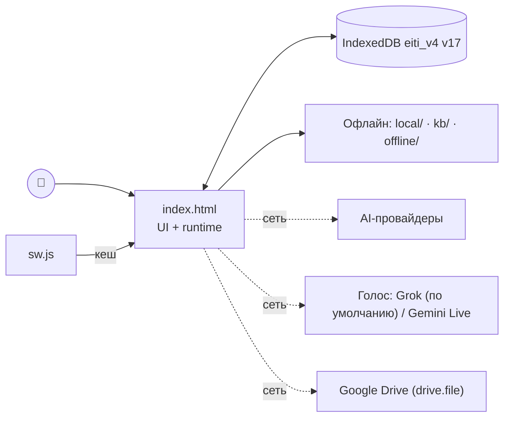
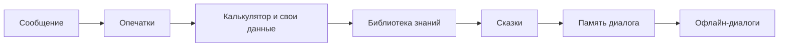

> **Это тестовая копия** [velantrim-eiti](https://github.com/velantrian/velantrim-eiti) с функцией Notes Ask AI. Не основной репозиторий и не продакшен.

<div align="center">

# 𓆩 VELANTRIM EITI 𓆪

**Персональный AI-ассистент с многослойной памятью**  
_Клиентское PWA без backend и build step. Основной интерфейс — один HTML-файл._

[](https://github.com/velantrian/Eiti-Test-Notes/commits/main)
[](#)
[](#)
[](#)

</div>

<div align="center">

**[🚀 Установить](#-установить-приложение) · [🆕 Что нового](#-что-нового-в-v14100) · [🏗️ Как устроен проект](#️-как-устроен-проект) · [📐 Архитектура подробно](docs/ARCHITECTURE.md) · [⚠️ Ограничения PWA](docs/PWA_LIMITS.md) · [🤖 AGENTS.md](AGENTS.md)**

</div>

---

## 🚀 Установить приложение

<div align="center">

### [▶️ Открыть VELANTRIM EITI](https://velantrian.github.io/Eiti-Test-Notes/)

**📱 На телефоне:** открой ссылку в Chrome → меню (⋮) → «Добавить на главный экран»

**💻 На компьютере:** открой ссылку в Chrome → значок установки в адресной строке (⊕)

</div>

---

## ⬇️ Локальный запуск

Скачайте [полный репозиторий](https://github.com/velantrian/Eiti-Test-Notes/archive/refs/heads/main.zip) и запустите его через статический HTTP-сервер:

```bash
python3 -m http.server 8080
```

Откройте `http://localhost:8080/index.html`. Для полного функционала нужны companion-файлы `sw.js`, `manifest.json`, иконки, `sql-wasm.js/.wasm` и `data/`. Один `index.html`, открытый через `file://`, может показать базовый UI, но Service Worker, SQLite-поиск и часть импорта документов не гарантируются.

---

## 🏛️ Как устроено приложение целиком (кратко)

| Часть | Как сейчас | Подробно |
|---|---|---|
| Код | один `index.html` (UI + логика) + UMD-модули `local/`, `kb/`, `offline/`; без backend и без сборки | [§2](docs/ARCHITECTURE.md#2-структура-файлов) |
| Хранение | **IndexedDB `eiti_v4`** — основные данные (чаты, заметки, файлы, KB, L2/L3, дневник); **localStorage** — только настройки, флаги, ключи API, короткий профиль; **SQLite WASM** — производный поисковый индекс | [§12](docs/ARCHITECTURE.md#12-полная-карта-хранения-данных) |
| Память | L1 история → L2 дайджесты → L3 профиль + выученные факты + KB с Truth Gate; «не запоминай» соблюдается, исправления хранят историю | [§12.4](docs/ARCHITECTURE.md#124-слои-памяти) |
| Синхронизация | Google Drive (`drive.file`, `EITI/eiti_backup.json`), LWW по записи, надгробия 90 дней, секреты не синхронизируются | [§14](docs/ARCHITECTURE.md#14-синхронизация-подробно) |
| PWA / офлайн | `sw.js` (CORE + офлайн-пакеты), `manifest.json`, офлайн-ответы без сети и ключа | [§15](docs/ARCHITECTURE.md#15-pwa-и-офлайн-подробно) |
| Сборка и тесты | генераторы данных KB/сказок; CI: node, pytest, Playwright, folklore | [§16](docs/ARCHITECTURE.md#16-сборка-инструменты-и-ci) |
| GitHub Pages | сейчас публикуется весь репозиторий (`path: .`, включая `folklore/`); PR #45 вводит белый список | [§17](docs/ARCHITECTURE.md#17-что-публикуется-на-github-pages) |
| Экспорт | `eiti.archive.v1` (JSON) — формат сохраняется между версиями | [§13](docs/ARCHITECTURE.md#13-экспорт--импорт-eitiarchiveexport--eitiarchiveimport) |
| Нативное приложение | соответствие веб → натив и инварианты | [§18](docs/ARCHITECTURE.md#18-перенос-в-нативное-приложение) |

📐 Полная архитектура (для переноса в нативное приложение): **[docs/ARCHITECTURE.md](docs/ARCHITECTURE.md)**.

---

## 🆕 Что нового в v14.15.4

- 💬 **Поле ввода как в ChatGPT**: текст на всю ширину сверху (растёт до ~6 строк), ниже в той же скруглённой карточке — компактный ряд: слева «+» (меньше, без толстого золотого круга), справа ↶ отменить, ↷ повторить, (♻ очистить), 🎤 и ➤ (кнопки 40 px, ряд помещается на 360 px). Режим «кнопки» (классическая панель), вложения, диктовка, стоп/отправка, темы — как раньше.
- ↶ ↷ **Отмена/повтор ввода**: своя история поля (шаги по словам/паузам, до 100 шагов, диктовка/вставка/очистка тоже отменяются, после отправки история сбрасывается; Ctrl/Cmd+Z, Ctrl+Shift+Z / Ctrl+Y). Неактивны, когда нечего отменять. EN Undo/Redo, DE Rückgängig/Wiederholen.
- ♻ **«Кнопка очистки в поле»** — переключатель в меню «+» прямо у пункта «Очистить ввод»: вкл — ♻ стоит в нижнем ряду карточки рядом с ↶ ↷ (тап — очистить, двойной тап — скопировать чат); выкл (по умолчанию) — кнопки нет. Ключ `eiti_inline_clear`, применяется сразу и до первой отрисовки.
- 📜 **Ответ показывается с начала**: при новом ответе ассистента чат прокручивается так, что верх ответа — вверху видимой области (длинный ответ читается с начала, короткий — целиком). Если во время ответа пролистать вверх — прокрутка не перехватывается; долистали до низа — дальше как раньше. Свои сообщения — как раньше (вниз).

## 🆕 Что нового в v14.15.2

- **📱 Экран телефона** (Настройки → Внешний вид): выбор формы экрана — «Авто» (по умолчанию, как раньше), iPhone с чёлкой (X–13), iPhone с Dynamic Island (14 Pro–17), iPhone SE, Samsung Galaxy S, Galaxy Z Fold/Flip, Xiaomi/Redmi/POCO, Google Pixel, «Без выреза». Пресет задаёт минимальный отступ сверху/снизу (в альбомной — сбоку), системный safe-area никогда не уменьшается. Живое превью телефона, подсказка «Похоже, у вас … — применить?» (сама ничего не меняет). Совместимо с «Меньше иконки» (одна и та же safe-area, кнопки шапки — под вырезом), светлой/тёмной темой, RU/EN/DE. Неизвестные/служебные значения в настройке (`__proto__`, `constructor` …) → «Авто»; запоздалая подсказка после ручного выбора не показывается.

## 🆕 Что нового в v14.15.1

- 🔍 **«Меньше иконки (small icons)»** — галочка в **Настройки → 📌 Настройка табов** (рядом с видимостью табов и шапки). Нижний таб-бар 110 → 50 px, верхняя шапка 88 → 44 px, компактные шапки заметок, редактора (↶ ↷ 📋 ⋯), подэкранов настроек и просмотрщика файлов — на экране помещается больше текста. По умолчанию выкл (вид как раньше); зона нажатия таба ≥ 36 px, у компактных кнопок шапок — невидимая зона ≥ 44 px (графика не растёт); safe-area iPhone учитывается, кнопки шапки центрируются ниже выреза/Dynamic Island; применяется сразу и при запуске до первой отрисовки (ключ `eiti_small_icons`). EN «Small icons», DE «Kleine Symbole».

## 🆕 Что нового в v14.15.0

- 🧩 **Офлайн-интенты EITI Frames**: новые типы вопросов — «чей / чья», «с кем / от кого / к кому / для кого», «насколько / в какой мере», «до каких пор / как долго ещё», «который из / что выбрать из», «небось / ведь / авось», просьбы («проверь», «расставь», «пришли»). Все 130 фраз аудиторского корпуса теперь распознаются (было 44 без интента).
- 🗣️ **Составные реплики**: «ок, расскажи о космосе», «Спасибо! А что такое луна?» — зачин не мешает; «Что такое наука. А зачем она?» — два ответа подряд. «А дальше-то?» — продолжение; «максимально подробно», «tldr», «как для чайника», «можно короче».
- 🔢 **Нормализация**: «-то / -ка» («скажи-ка»), растянутые буквы («неее» → «нет»), числа словами («двадцать один» → 21), ё/е.
- 💛 **EITI Care**: «я не хочу умирать» — мягкий ответ без тревоги (с номерами), «умираю со смеху», «убить время», «я влюбился(ась)», «мне грустно и я не знаю что делать»; «в книге герой покончил с собой» — мягко «если речь о тебе» с контактами. Добавлен русскоязычный телефон доверия **«Доверие» (Doweria) 030 440 308 454** (круглосуточно). ⚠️ Номера проверять вручную перед релизом.

## 🆕 Что нового в v14.14.0

- 🧩 **EITI Frames** (`local/eiti_frames.js` + `local/eiti_frames.json`): офлайн-понимание формулировок в любом порядке слов — «Расскажи о науке», «о науке расскажи», «Скажи / объясни / поясни / растолкуй / разложи по сути…», вопросы «зачем / когда / сколько / как / откуда / для чего / каким образом / это точно?», уточнения по теме разговора («а зачем?», «а кто придумал?»). Исправление оговорки диктовки «поцелуй» → «поясни» (только перед темой).
- 📘 **Карточки понятий** (`kb/src/kn_*.txt` → ленивые разделы KB `kn_*`): 570+ карточек (определение, кратко, пример, зачем, применение, как устроено, когда, происхождение, кто, проверка) — наука, физика, химия, биология, космос, Земля, математика, информатика, экономика, общество, психология, философия, здоровье, язык, культура, история, природа, география, техника, быт. Загружаются по требованию при первом вопросе-понятии, проверяются `kb/tests/validate_cards.py`.
- 📴 **Офлайн — только из своей базы**: если ни фреймы, ни KB, ни заметки не знают ответа — коротко «🤷 Не знаю, этого нет в базе: «тема»» (тема запоминается локально, никуда не отправляется). Настройки → «🔄 Обновить базу офлайн-ответов»: скачиваются только изменившиеся пакеты базы (по `offline_manifest.json` с хешами) и, если отмечено «Добавлять темы, на которые не было ответа, из Википедии», краткие статьи ru-Википедии по этим темам — они сохраняются на устройстве как карточки «🌐 из Википедии» и дальше работают без сети. Без фоновой сети и трекинга.
- 🧭 Вместо «⚠️ Настройте DeepSeek API ключ» на обычный вопрос без ключа — понятный ответ с кнопками [🔍 Поискать в заметках] [🤖 Включить ИИ]; сообщение о ключе осталось для явных ИИ-функций.

## 🆕 Что нового в v14.13.1

- 🎙️ EitiVoice P1-1: при обрыве — до 2 переподключений (1 с / 3 с), без повторов при ошибке ключа или лимита; запасной провайдер только по нажатию; «✍️ Написать текстом».

## 🆕 Что нового в v14.13.0

- 🔗 **«Похожие / Related / Ähnliche»** под ответами библиотеки знаний KB, офлайн-сказками и заметками (в т.ч. Notes Ask AI): чипы, по нажатию открывается запись. Для KB похожие вычисляются при сборке (`kb/related.py`: общие факты Wikidata — автор, страна, война, класс — плюс лексическая близость в разделе; поле `r` в пакетах, не в поисковом индексе), для сказок — `offline/build_tale_related.py` (традиция, персонажи, темы, мотив; поле `rel`), для заметок — TF-IDF на устройстве без сети + записи KB.
- 🧠 **«Рассуждение / Reasoning / Begründung»**: офлайн — карточка (заголовок, описание, блок фактов, раздел, источник) только из данных записи; в режиме «С ИИ» — объяснение тем же ИИ-провайдером, с опорой на карточку и отдельным блоком от проверенных фактов (заметки — только при включённом Notes AI).
- ⚙️ Настройки → «🔗 Похожие и рассуждение»: «Показывать похожие», «Подробное рассуждение», режим (только офлайн / с ИИ). По умолчанию: всё включено, офлайн. RU/EN/DE.

## 🆕 Что нового в v14.12.0

- 🗣️ **Голосовой ассистент на выбор** (Настройки → ИИ → «Голосовой ассистент»): Grok Voice, Gemini Live, **OpenAI Realtime** (WebRTC, свой ключ), **Qwen Omni Realtime** и **Алиса (Яндекс)** — через свой WebSocket-прокси (браузер не умеет передавать ключ в заголовке), **Mistral Voxtral** (распознавание Voxtral → чат Mistral → голос браузера или Voxtral TTS).
- 🌀 **Mistral AI как обычный ИИ чата**: карточка провайдера с ключом и моделью (Medium 3.5, Large 4, Small 4, Ministral 3 14B/8B) и группа в меню «+» → ИИ.

## 🆕 Что нового в v14.11.0

- 🎤 **Голосовой ввод в поле сообщения** (Web Speech API): нажми 🎤 — текст появляется прямо в поле (промежуточные результаты видны сразу), нажми ещё раз — стоп; сообщение само не отправляется. Язык — язык приложения (ru-RU / en-US / de-DE). В Chrome распознавание идёт через серверы Google (нужен интернет); без сети — на устройстве (`processLocally`, языковой пакет скачивается), иначе — подсказка про офлайн-ввод в Gboard. Подробнее — [docs/PWA_LIMITS.md](docs/PWA_LIMITS.md).
- 🗣️ **Голосовой ассистент** (Grok Voice / Gemini Live) теперь в меню **«+»** слева: рядом подписан выбранный провайдер и ссылка «изменить» → Настройки → AI → «Голосовой ассистент». Та же ссылка есть в меню типа дневника.
- 🤖 **AI чата в «+»**: одна строка — текущий провайдер и модель (напр. «DeepSeek · V4.1 Flash»), «изменить» и вкл/выкл. «изменить» закрывает «+» и открывает отдельную компактную панель снизу (≤ 60 % экрана, ✕ и тап по фону закрывают): провайдеры свёрнуты (иконка, имя, текущая модель или «🔑 нужен ключ»), тап раскрывает модели (открыт один, текущий — по умолчанию), плюс «Отключить AI». Выбор применяется сразу, сохраняется туда же, что и в Настройках, и закрывает панель; «нужен ключ» ведёт к полю ключа в Настройках.
- 🔗 Ссылки «изменить» в «+» и «🗣️ Голосовой ассистент…» в меню дневника сразу открывают Настройки → AI → «Голосовой ассистент».

## Что было в v14.10.0

- 🧮 **Офлайн-калькулятор понимает английский и немецкий**: числа словами (*twenty-five*, *a hundred*, *zweiundzwanzig*, *hundert*), операторы (*times*, *divided by*, *to the power of*, *mal*, *geteilt durch*, *hoch*), вопросы (*what is…*, *was ist…*), *half of / die Hälfte von / половина от*, корень, десятичная запятая (*2,5*, *komma*). Отвечает на языке пользователя и в его формате чисел (`2,5` и `20.000` в DE, `2.5` и `20,000` в EN).
- 📚 **Поиск в библиотеке знаний стал умнее**: падежи («о Наполеоне», «Наполеона») → лемма, аббревиатуры и написания (МГУ, МФТИ, США, СССР, «эппл» → Apple), транслитерация (*napoleon* ↔ «наполеон»). Добавлена статья Apple. Точность top-1 на отложенном наборе: 0.921 → 0.940.
- 💬 **Действия с сообщением** — один компактный ряд приглушённых иконок под текстом, рядом со временем и Trace (≥ 32 px, RTL). Исправлен дубль 🔊📋 у длинных офлайн-ответов.
- ⌨️ **Поле ввода** — в одну строку («Сообщение…» / «Message…» / «Nachricht…»), растёт до ~6 строк, после отправки сжимается. Подсказка про Enter — во всплывающей подсказке.
- 🌍 **Полный перевод интерфейса на EN и DE**: настройки, голос, плеер, подсказки, тосты, `aria`/`title`. Автотест сканирует все основные экраны на кириллицу.
- ✅ **Стабильный e2e**: тесты ждут явного флага готовности чата `window.eitiChatReady`, а не таймеров.
- 📐 Новый документ [docs/ARCHITECTURE.md](docs/ARCHITECTURE.md).

---

## 🏗️ Как устроен проект

EITI — **клиентское PWA без backend и без сборки**. GitHub Pages раздаёт статические файлы; всё — интерфейс, память, офлайн-ответы, синхронизация — работает в браузере. Подробно, с диаграммами: **[docs/ARCHITECTURE.md](docs/ARCHITECTURE.md)**.



### 📂 Файлы

| Путь | Назначение |
|---|---|
| `index.html` | Всё приложение: UI, IndexedDB, память, провайдеры, голос, Drive, i18n |
| `sw.js` · `manifest.json` | Service Worker (кеши `eiti-v*` и `eiti-offline-v*`) и манифест PWA |
| `local/` | Офлайн-движки: калькулятор RU/EN/DE (`eiti_local.js`), опечатки, память диалога, дневник, слияние для Drive |
| `kb/` | Библиотека знаний ~29 тыс. статей: движок `eiti_kb.js`, исходники `src/`, сборка `build_kb.py` |
| `offline/` | Офлайн-диалоги и сказки RU/EN/DE |
| `velantrim_core/` | Тесты: `tests_js/` (Node), `tests/` (pytest), `e2e/` (Playwright) |
| `docs/` | [ARCHITECTURE.md](docs/ARCHITECTURE.md), [PWA_LIMITS.md](docs/PWA_LIMITS.md) и др. |

### 🗄️ Данные

| Где | Что |
|---|---|
| IndexedDB `eiti_v4` **v17** | `chats`, `messages`, `notes`, `files`, `kb`, `l2`, `l3`, `reasoning`, `pkg`, `tasks`, … и **`journal`** (дневник: одна запись на пункт) + **`contexts`** (темы) |
| localStorage | тема, язык, настройки, API-ключи (ключи никогда не синхронизируются) |
| SQLite WASM | производный поисковый индекс, перестраивается из IDB |

### 📓 Дневник

Каждый пункт (цель, факт, вопрос, пробел, решение) — отдельная запись с `chatId`, `contextId`, `msgIds`, `hash`, `createdAt/updatedAt`. Дубли ищутся по хешу внутри чата, удаление — надгробие `del:1`. В контекст ИИ сначала идёт текущий чат, потом его тема, потом остальное.

### ☁️ Синхронизация с Google Drive

| | |
|---|---|
| Вход | Google Identity Services, scope `drive.file` (только свои файлы), один раз |
| Файл | `EITI/eiti_backup.json` |
| Слияние | по каждой записи: `id` + `updatedAt`, побеждает более новая |
| Удаления | надгробия хранятся 90 дней |
| Client ID | `EITI_GOOGLE_CLIENT_ID` в `index.html` — пустая заглушка, вписывается владельцем развёртывания |

### 🔌 Офлайн-конвейер



Первый уверенный слой отвечает — на языке пользователя (RU/EN/DE).

### 🗣️ Голос

**Голосовой ассистент** (реальное время): **Grok Voice** — по умолчанию, **Gemini Live** — по выбору; запускается из меню «+», выбор — Настройки → AI → «Голосовой ассистент» (ссылка «изменить» в «+» и в меню дневника). Без ключа — тост с кнопкой переключения.

**Голосовой ввод** (🎤 в поле): Web Speech API, онлайн через Google в Chrome; без сети — распознавание на устройстве, если браузер умеет; не отправляет сообщение сам.

### 🧪 Тесты и CI

| Уровень | Команда |
|---|---|
| Node | `node --test velantrim_core/tests_js/*.test.js` |
| pytest | `cd velantrim_core && pip install -r requirements.txt && pytest tests/` |
| Playwright | `cd velantrim_core/e2e && npm ci && npx playwright test --project=chromium` |

CI (`.github/workflows/test.yml`) запускает все три уровня на каждый PR в `main`; после merge `pages.yml` публикует сайт.

### 🚢 Релиз

Ветка `feat/vX.Y.Z` → версия синхронно в `index.html`, `sw.js`, `manifest.json`, `README.md`, `AGENTS.md` → тесты → PR → зелёный CI → merge владельцем. Подробнее — [ARCHITECTURE.md § 11](docs/ARCHITECTURE.md#11-процесс-релиза).

---

## Что было в v14.9.0

- 📓 **Дневник — запись на каждый пункт.** Цели, факты, вопросы, пробелы и решения хранятся отдельными записями в IndexedDB `journal` (`chatId`, `contextId`, `msgIds`, `hash`, `createdAt/updatedAt`, `del`), темы — в `contexts`. База обновлена до v17; старый дневник переносится автоматически один раз (копия остаётся как `eiti_rne_data_v1_bak`). Интерфейс дневника не изменился.
- 💬 **«Отдельный для каждого чата» теперь работает по-настоящему**, «по датам» сортирует по дате изменения, «умный» — по темам. Дубли определяются по тексту внутри чата, а не по первым 60 символам. «Анализ истории» разбирает каждый чат отдельно и привязывает пункты к нему. В контекст ИИ сначала идёт текущий чат, потом его тема, потом остальное.
- 🗑 Удаление — метками `del:1`, поэтому удалённое не возвращается при синхронизации; удаление чата оставляет его пункты без привязки. Дневник синхронизируется с Google Drive.
- 🗣️ **Выбор голосового ассистента**: Настройки → «Голосовой ассистент»: **Grok Voice** (по умолчанию) или **Gemini Live**. Кнопка голоса подписана выбранным провайдером. Нет ключа или сбой соединения — тост с кнопкой «Переключить на …». iPhone: пересэмплирование микрофона в 16 кГц, AudioContext создаётся в нажатии.
- 📄 [Что не работает в PWA и что заработает в нативном приложении](docs/PWA_LIMITS.md).

## Что было в v14.8.0

- ⌨️ **Терпимость к опечаткам офлайн** (`local/eiti_typo.js`): перед калькулятором, командами заметок, KB, сказками, памятью диалога и офлайн-интентами сообщение нормализуется — ё→е, ш/щ, удвоенные/пропущенные буквы, соседние клавиши (ЙЦУКЕН / QWERTY / QWERTZ), неверная раскладка (*ghbdtn* → «привет», *руддщ* → «hello»), пропущенные пробелы/дефисы («кактвои дела», «чтото»), регистр.
- 🔎 **Нечёткое сопоставление** по словарю всех офлайн-слоёв (Дамерау–Левенштейн: ≤3 букв — только курируемая таблица «еше / ище → ещё», 4–7 — 1 правка, 8+ — 2); частые слова в приоритете, правильные слова не переписываются (список общеупотребительных слов RU/EN/DE + защита словоформ). Индекс symmetric-delete строится лениво при первом офлайн-запросе; словарь `local/eiti_typo_vocab.json` тоже грузится лениво — на старте 0 запросов.
- 🇩🇪 **Немецкий**: сравнение по «свёрнутой» форме (ü→ue, ä→ae, ö→oe, ß→ss) для ввода и словаря — *Taetigkeit*, *Strasse*, *Wasser*, *neue* не ломаются, *Tatigkeit* → *Tätigkeit*; плюс небольшая таблица частых опечаток (*dnake → danke*, *vileicht → vielleicht*).
- 📚 Список общеупотребительных слов `local/typo_guard.txt` получен из FrequencyWords (hermitdave, 2018, на основе OpenSubtitles; код — MIT); пересборка: `node local/build_typo_vocab.js --freq-dir DIR`.
- 💬 Подсказка «понял как: …» показывается только при исправлении раскладки (переписано всё сообщение); мелкие исправления — молча.

**Также в v14.8.0 (из v14.5.0, PR #30):**

- **Память диалога офлайн** (`local/eiti_dstate.js`): слоты *тема / сущность / место / время / цель / настроение*. «Хочу в Грузию весной» → «а что там посмотреть?» понимается как «что посмотреть в Грузии» (и так уходит в KB). Отсылки *там / туда / оттуда / тогда / он / она / это*, *there / then / he / it*, *dort / dorthin / damals / er / es*.
- **Стек тем**: «о чём мы говорили?», «вернёмся к …», *back to …*, *zurück zu …*; темы угасают через несколько реплик.
- **Фреймы**: планирование поездки (куда → когда → план) и выбор между вариантами («A или B?» → критерий → совет).
- **Уточнения**: при неоднозначной отсылке — «Ты имеешь в виду X или Y?». С подключённым ИИ в системный контекст уходит компактная сводка состояния.
- **Настройки → 💾 Размер чата и хранилище**: объём истории, офлайн-кэшей/KB, памяти диалога и общий (`navigator.storage.estimate`); очистка истории / кэшей / сброс памяти (с подтверждением, заметки и файлы не трогаются); лимит «Хранить сообщений» 200 / 500 / 1000 / без ограничений с авто-удалением самых старых.

## 🆕 Что нового в v14.7.0

- ☁️ **Google Drive: вход один раз и автосинхронизация.** Кнопка «Войти через Google» (согласие только в первый раз, дальше тихое продление токена). Синхронизация сама: при открытии, через ~8 с после изменений, при сворачивании (отправка) и возврате (получение). Файл тот же: `EITI/eiti_backup.json`, существующая папка используется повторно. Слияние по id и времени изменения, метки удаления, настройки по ключам, API-ключи никогда не уходят на Drive. Восстановление пишет заметки, чаты, файлы и настройки прямо в IndexedDB без перезагрузки. Движок слияния: `local/eiti_drive_sync.js` (грузится лениво).
- Общий OAuth Client ID задаётся константой `EITI_GOOGLE_CLIENT_ID` в `index.html`; пока она пустая, работает ID, введённый в настройках. Scope `drive.file` видит только файлы, созданные тем же Cloud-проектом.

## 🆕 Что нового в v14.4.0

- 🌐 **Офлайн-ответы на языке приложения и сообщения (RU / EN / DE).** Раньше без ключа ИИ в EN/DE-интерфейсе часть ответов приходила по-русски. Теперь язык выбирается так: явная настройка «язык ответов ИИ» → язык самого сообщения (кириллица → RU, немецкие признаки → DE, английские → EN) → язык приложения. Русское поведение не изменилось.
- 🧮 **EITI Local** (калькулятор и вопросы о заметках/файлах) отвечает шаблонами на RU/EN/DE, понимает немецкие числа и операции («zwanzig prozent von dreihundert», «sieben mal acht») и вопросы («wie viele Notizen habe ich», «finde in meinen Notizen …»).
- 🧠 **KB**: для EN/DE — английский текст статьи; статьи без перевода не показываются по-русски, вопрос уходит офлайн-диалогам.
- 💬 **Офлайн-диалоги**: новый `offline/eiti_offline_de.js` — немецкие шаблоны для основных намерений (приветствия, спасибо, как дела, помощь, прощание, кто ты, что умеешь, настроение…); остальное — по-английски, без машинного перевода. Подсказка «нет ключа», подписи «офлайн-ответ» и чипы «открыть/скачать» — тоже на нужном языке.

## 🆕 Что нового в v14.3.0

- 📚 **Библиотека знаний выросла до ~29 тыс. статей** (было ~11 тыс.): 27 новых разделов — космос (планеты, спутники, созвездия, звёзды), космические миссии, минералы, динозавры, болезни (только справочно), анатомия, компании, научные законы, праздники, достопримечательности, музеи, университеты, моря и вулканы, пустыни, видеоигры, оперы и балеты, мифология, религии, писатели, композиторы, художники, философы, учёные, нобелевские лауреаты, спортсмены, клубы и виды спорта, аэропорты; плюс новые сущности в существующих разделах.
- 🧹 Только новое: дедупликация по триггерам с ручными статьями и прежними разделами (`build_kb.py --strict`), фильтры вандализма в описаниях, без событий после 2020 и без несовершеннолетних.
- 📱 Быстро на iPhone: компактные шарды v3 (префиксы и номера пачек не повторяются), индекс по-прежнему ленивый и шардированный.
- 🛡️ Болтовня («привет, как дела?», «доброе утро») не перехватывается названиями фильмов/книг.

## 🆕 Что нового в v14.2.0

**EITI Local — простой интеллект по твоим данным и калькулятор, полностью офлайн.** Работает без ключа и без сети и проверяется раньше библиотеки знаний и офлайн-диалогов (движок `local/eiti_local.js`, без eval).

- 🗂 **Заметки и файлы:** «сколько у меня заметок», «сколько файлов», «сколько места занимают файлы», «последняя заметка», «что я писал вчера», «заметки за эту неделю», «сколько заметок за прошлый месяц», «самая длинная заметка», «заметки с тегом работа», «что в заметках про отпуск», «найди в файлах договор». В ответе есть кнопки «📝 … · открыть» и «📄 … · скачать». Понимает и английский: «how many notes», «last note», «notes about X», «what did I write yesterday».
- 🧮 **Калькулятор:** цифры, скобки, степени, проценты (`(2+3)^2`, `200+10%`, `15% от 80`) и русские числительные: «два умножить на три» → `2 × 3 = 6`, «сто сорок разделить на семь», «пять плюс 12», «двадцать процентов от трёхсот», «квадратный корень из 81», «минус пять в квадрате», «два и пять умножить на два», «десять с половиной». На ноль не делит, обычные фразы, даты и числа в тексте не перехватывает.
- 📚 **Библиотека знаний:** исправлены промахи (валюта Японии, язык Бразилии, волк, «Крёстный отец», Первая мировая), добавлены статьи «Гамлет», «1984», «Пельмени» и «Лунная соната».

## 🆕 Что нового в v14.1.0

**Библиотека знаний KB: общие знания без сети и как контекст для ИИ**
- `kb/`: 11 110 справочных записей в 33 разделах. 549 записей написаны и проверены вручную (14 тематических разделов; здоровье — только справочно, не замена врачу). Ещё ≈10 560 сгенерированы из Wikidata (CC0) скриптом `kb/gen/gen_kb.py`: люди, страны, города, химические элементы, реки, горы, озёра, острова, виды, книги, картины, музыка, фильмы, события, войны, блюда, языки, языки программирования, понятия. Индекс разбит на шарды (`kb/idx/*.json`, ≈363 КБ gzip всего, крупнейший ≈71 КБ). Ответы — в пакетах до 400 записей (крупнейший ≈23 КБ gzip). Ничего не грузится при старте: фоновый прогрев начинается через 6 с после load, индексация идёт порциями в idle.
- Офлайн (нет сети, ключа или ИИ упал) уверенный ответ KB идёт первым — в чате и в Notes Ask AI, с пометкой «🧠 KB · раздел».
- С ИИ: до 4 найденных записей добавляются в системный контекст («БИБЛИОТЕКА ЗНАНИЙ EITI»), в источниках ответа — «📚KB·N».
- Лениво: индекс (~48 КБ gzip) строится порциями в простое через 6 с после загрузки; ответы лежат в пакетах по разделам и грузятся по требованию. Кеш — Service Worker (`eiti-offline-*`), не localStorage. Личные факты (KB_ADD) — прежний слой в IndexedDB.
- Сборка: `python3 kb/build_kb.py` из `kb/src/*.txt` (дубли триггеров и ответов отбрасываются). Точность поиска на отложенных перефразах: `node kb/tests/eval_kb.js`.

## 🆕 Что нового в v14.0.0

**Офлайн-диалоги: EITI разговаривает без сети и без ИИ**
- Когда нет интернета, нет ключа или ИИ вернул ошибку, чат и Notes Ask AI отвечают локально: живые диалоги с контекстом (понимают «да / нет / почему / ещё» на свой прошлый вопрос), ~1750 намерений RU/EN.
- Подборки: пословицы и мудрость, крылатые цитаты, анекдоты, скороговорки, загадки, факты, стихи.
- **Сказки и предания (522):** славянские, европейские, тюркские, кавказские, кельтские/ирландские и о друидах. «Расскажи сказку», «дальше», «а мораль?», «кто такой Кухулин», «сказку на ночь» (спокойный режим).
- **Стиль ответов** в Настройках → ✈️ Офлайн-режим: авто, тёплый, вежливый, простой, деловой, с юмором.
- Файлы в `offline/` грузятся лениво (ядро ~190 КБ gzip после старта в простое, пакеты — по запросу), кешируются Service Worker'ом в отдельном кеше; состояние диалога хранится в IndexedDB `eiti_offline`.
- Включает все изменения v13.9.0 (#24).

## 🆕 Что нового в v13.9.0

**Обучение: MOSC, 👍/👎, адаптивный поиск, память, защита AI-правок**
- **MOSC подключён:** перед отправкой EITI определяет намерение. Если не уверен, под сообщением появляется карточка «Кажется, ты хочешь…» с вариантами. Отправку она не блокирует. Выбор обучает граф. Голосовой Grok снова видит граф MOSC.
- **👍/👎 учат по-настоящему:** оценка сохраняется вместе с провайдером, моделью, намерением и фактами KB, которые были в контексте. У каждого факта появляется «полезность», и она влияет на ранжирование. Эффект на PKG симметричный (±1). В Настройках видно, какую модель и длину ответа ты предпочитаешь.
- **Адаптивный поиск памяти:** Thompson sampling перебирает 4 пресета порога и числа фактов и учится на оценках. Есть вкл/выкл и сброс. Режим поиска теперь работает: Hybrid = BM25 + эмбеддинги, «Семантика», «FTS». Группа переименована в «⚖️ Веса поиска памяти».
- **Память фактов:** ранжирование по формуле свежесть × важность × релевантность. Почти одинаковые факты сливаются. Рядом с лимитом память сжимает LLM (ADD/UPDATE/DELETE), это видно и можно отменить. Вместо жёсткого удаления факты уходят в архив. Лимит важности (2.5) теперь достижим.
- **Защита AI-правок:** значения MOSC_ADD/DEL, FL_SET и PKG ограничиваются, на один ответ действуют лимиты. Теги из цитат, кода, вставленного текста и файлов игнорируются. Каждое изменение пишется в журнал, его можно отменить.
- **Метрики на устройстве:** доля 👍 по версиям и конфигурациям поиска, «до/после» для каждого изменения MOSC/FL/PKG.

## 🆕 Что нового в v13.8.1

**iPhone Safari: адаптация по итогам аудита**
- Подсказка «Установить EITI» показывается один раз за всё время, сама скрывается через 7 с, стоит внизу над панелью вкладок и не закрывает шапки, редакторы и просмотр файлов.
- На iOS поля ввода, textarea и select — 16px: Safari больше не зумит страницу при фокусе (на других платформах вид не меняется).
- Окно файла учитывает чёлку / Dynamic Island / home-индикатор (`env(safe-area-inset-*)`), в том числе в landscape.
- Панель AI Docs в Файлах поднимается над клавиатурой (тот же visualViewport-код, что в Notes AI).
- Зоны нажатия ≥ 44px без изменения вида: цвета фона, ✨ Оформить, ➕ Блок, 📄 Текст/📖 Reader, ✏️ 📋 ✕, кнопки шапки заметки, 👍/👎, кнопки сообщений.
- iPhone SE: «Ask AI» и «Настройки» не переносятся, нет лишнего пикселя прокрутки у панели вкладок.
- Landscape / широкий экран: шапка файла в одну строку, если помещается.
- `100dvh` с запасным `100vh`; проверка `window.Notification` перед обращением.
- Подсказка установки знает iPadOS и называет Chrome / Firefox / Edge на iOS правильно.
- E2E: проект `webkit-iphone` (iPhone 13), SW заблокирован, чтобы моки AI работали.

## 🆕 Что нового в v13.8.0

**Файлы и заметки: оформление, AI Docs, ИИ без обрезки**
- Окно файла: название и кнопки ✏️ 📋 ✕ перекрашиваются под фон (белый / чёрный / бумажный), контраст не ниже 4.5:1. По умолчанию — светлая тема, выбор запоминается.
- 👁 / ✎ в заметках и файлах: просмотр с оформлением — Markdown (таблицы, вложенные списки, ссылки, сноски, задачи), Obsidian (`[[ссылки]]`, сворачиваемые `> [!note]-`, `==выделение==`, `#теги`, скрытые `%%комментарии%%`, свойства YAML), диаграммы Mermaid (грузятся с CDN только при наличии диаграммы; без сети показывается код), эмодзи и символы как есть. HTML из текста не исполняется.
- AI Docs в файлах: внизу файла 🔍 / ✨ Ask AI / ✎, как в заметках; правки ИИ подсвечиваются, ↶↷ отменяют и повторяют. Вкл/выкл — Настройки → ✨ Files AI → «AI Docs в файлах».
- Notes AI и AI Docs: ИИ помнит прошлые вопросы окна; лимит ответа увеличен, обрезанная правка не применяется молча — показывается предупреждение; для текстов от 30 000 символов — подсказка о точечных правках. «Как в чате» с ChatGPT и Grok использует именно выбранную модель.

### Выпуск v13.7.23

**Заметки: ↶ Отменить / ↷ Повторить в шапке и теги без пустой полосы**
- В шапке заметки, перед 📋, — кнопки ↶ «Отменить» и ↷ «Повторить» (изогнутые стрелки, плитки как у 📋/⋯). Работают для любых правок: набор текста, вставка, вырезание, формат, заголовок, теги, правки ИИ. История — до 50 шагов на заметку; набор текста объединяется в шаги по паузе. Недоступная кнопка приглушена. Горячие клавиши: Ctrl/Cmd+Z, Ctrl+Y, Ctrl/Cmd+Shift+Z. Отмена и повтор сразу сохраняются.
- Нижний ряд Аб/↶/↷ убран; «Аб» теперь в меню ⋯ — «Подсветка правок ИИ» (вкл/выкл).
- Длинный заголовок сокращается с «…», а не сжимает кнопки.
- Без Notes AI строка тегов прижата к нижней навигации — пустой полосы больше нет.

### Выпуск v13.7.22

**Чат: «💾 Сохранить чат» и AI Voice с выбором провайдера**
- В меню «+» чата после «Скопировать чат» — «💾 Сохранить чат»: Markdown, PDF или TXT. В файле роли («Вы» / имя модели) и время сообщений; служебные сообщения пропускаются, картинки и вложения заменены плейсхолдерами. Имя файла — `chat-<название>-<дата>`.
- «Grok Voice» переименован в «AI Voice» во всём интерфейсе (меню, настройки, тосты, переводы). Старые настройки и история сохраняются.
- Настройки → «🗣️ AI Voice — провайдер»: Grok (xAI, по умолчанию, без изменений) или Gemini Live (модели gemini-3.8-live / gemini-3.8-live-extended-thinking / gemini-3.1-flash-live-preview, 30 голосов). Ключ — отдельный или общий ключ Gemini API. Кнопка 🎙️ (mute) работает с обоими.
- Обновление приложения теперь тихое: при запуске больше не всплывает тост с номером версии. Версия видна в Настройки → О приложении.

### Выпуск v13.7.21

**Заметки: светлый режим ☀️ и вставка «как есть»**
- ☀️ в меню ⋯ теперь переключает весь редактор на светлую палитру (переменные paper-light): ⋯, 📋, «Аб», ↶/↷, ✕, меню ⋯ и экспорта, чипы Ask AI и подсветка правок ИИ читаются. Выбор запоминается. Нижняя панель приложения не меняется.
- Вставка в заметку сохраняет текст точно: markdown, символы, NBSP, табы, эмодзи. Тело заметки больше не обрезается (trim) при сохранении и копировании 📋.
- Превью карточек показывает переносы строк и не ломает эмодзи; поле Ask AI многострочное (Enter — отправить, Shift+Enter — новая строка).
- Markdown-рендер (ответы Ask AI, PDF): код не искажается, «2 * 3» не теряет звёздочку, поддержаны ####, цитаты `>` и списки задач `- [ ]`/`- [x]`; нейтральные цвета для светлого и тёмного фона.

### Выпуск v13.7.20

**Шапка заметки и панель Ask AI**
- Убран чип «📄 Заметка» из нижней панели Ask AI — контекст текущей заметки по-прежнему уходит в модель.
- Кнопка подсветки — «Аб», а не карандаш; тост «Подсветка правок ИИ: вкл/выкл». «Аб»/↶/↷ видны только после правки ИИ.
- Шапка: ←, широкий заголовок, 📋, 💾, ⋯. Меню ⋯: «Аа Шрифт и цвет», «💾 Сохранить как файл», «📤 Отправить», 🔔, ☀️, история, 🗑 Удалить (красным, последним).
- Низ: 🔍 / Ask AI / ✎; «Аб»/↶/↷ только после правки ИИ. Клавиатура поднимает панель через visualViewport.

### Выпуск v13.7.19

**Заметки: подсветка правок Ask AI, шаг назад и экспорт**
- После Ask AI вставки подсвечиваются, удаления показываются зачёркнутыми; в сохранённый текст удаления не попадают.
- Кнопка 🖍 в шапке заметки включает и выключает подсветку (по умолчанию вкл.); цвета настраиваются.
- ↶ / ↷ — один шаг undo/redo правки ИИ, пара «до/после» хранится вместе с заметкой.
- «Сохранить заметку» в Markdown / PDF / TXT и «Отправить» через Web Share с запасными вариантами.

### Выпуск v13.7.18

**Фризы Android Chrome и DeepSeek Flash Vision**
- Поиск по истории чанков с yield и отменой устаревшего запроса; чат дописывает пузыри и подгружает историю страницами по 50.
- Idle-timeout стрима 90 с, rAF-батчинг текста, SW cache-first только для CORE/HEAVY/data.
- DeepSeek Flash — vision-провайдер (`deepseek-flash`); Pro для фото не используется.

### Выпуск v13.7.17

**Каталог AI-моделей (октябрь 2026)**
- Актуальные ID DeepSeek, Gemini, OpenAI, Claude, Grok, Qwen, OpenRouter и эмбеддингов.
- Сохранённые retired ID мигрируют на рабочие замены, не ломая выбор пользователя.
- Таймаут загрузки каталога OpenRouter, проверка ключей и watchdog TTS на Android.
- Self-awareness больше не сериализует весь DOM (`outerHTML`) — это вешало Android Chrome.

### Выпуск v13.7.16

**Управление мобильной панелью Notes AI**
- ↕️ Центральную ручку можно перетаскивать вверх и вниз; высота сохраняется между открытиями.
- ⛶ Двойное касание ручки разворачивает чат на весь экран и скрывает панели редактора; повторное касание возвращает прежний размер.

**Ask AI в заметках (как Notion)**
- ✨ Плавающая кнопка «Ask AI» в открытой заметке (Android 360–430px, тёмная и светлая темы).
- 💬 Панель чата с контекстом текущей заметки: вопросы, резюме, переписывание; ответы через `_eitiUniversalAICall`.
- 😊 Кнопка «Эмодзи» после «Вопросы» включает уместные эмодзи в ответах до повторного выключения; состояние сохраняется.
- ⚙️ Настройки «Notes AI»: выключатель LLM (по умолчанию ВЫКЛ — кнопка скрыта, запросов нет), модель (включая OpenRouter с логотипами) и размер панели.
- 🔒 Настройки в `localStorage`; HTML ответов проходит через `eitiRenderMarkdown` / DOMPurify.

**Files EITI — AI и форматы**
- 📄 Формат новых файлов выбирается в панели файлов: JSON или Markdown.
- ✨ Опциональный «Files AI» по умолчанию выключен; готовит редактируемый черновик в выбранном формате и сохраняет результат новым файлом, не меняя источник.

### Выпуски v13.7.6–v13.7.15
- **v13.7.15:** исправления аудита PR #93 и старых дефектов `main`.
- 🧠 Архивный контекст теперь сохраняется в payload провайдера; поиск работает и в сборках SQLite без FTS5 через IndexedDB fallback.
- 🎯 Единый детектор явных запросов к истории для русского, английского и немецкого; обычные темы и приветствия не запускают сканирование при выключенном автопоиске.
- 🎙️ Grok Voice использует текст текущего хода; Qwen и Vision проходят через общий контекстный gate.
- 💾 Backup включает IndexedDB `l3` и `kb`; миграция оставляет `Observed`/`Hypothesized` в L1 и не объявляет их подтверждёнными L3.
- 🔎 LIKE fallback ищет без SQL `ESCAPE`-ошибок, с поддержкой Unicode-регистра и апострофов; статус отдельно считает профиль и допущенные ESM L3-факты.
- 📡 Service Worker проверяет обновление сразу, обходит HTTP-кеш для `sw.js` и повторяет проверку каждые 5 минут.
- 🌐 Подписи, контракт, wireframe и инструкции согласованы с реальным выключенным по умолчанию поиском по L1-архиву; L2 и другие источники этим переключателем не управляются.
- Для существующих установок без сохранённого opt-in поиск также остаётся выключенным; сохранённое значение `eiti_memory_lookup_enabled='1'` продолжает включать автопоиск.

### Выпуски v13.7.6–v13.7.14
- **v13.7.14:** автопоиск архива выключен по умолчанию; уточнено разделение хранилищ L3.
- **v13.7.13:** бейдж Thinking только при наличии реального reasoning; одна повторная попытка при HTTP 429.
- **v13.7.12:** иконки free-моделей OpenRouter, более подробные ошибки 429 и бейдж скорости.
- **v13.7.11:** логотипы моделей OpenRouter и корректный Thinking OFF.
- **v13.7.10:** переключатель режима OpenRouter Thinking.
- **v13.7.9:** каталог бесплатных моделей OpenRouter.
- **v13.7.8:** эксклюзивный выбор AI-провайдера и переключатель Gemini Thinking.
- **v13.7.7:** модели Gemini 3.8 и подтверждение/статус ключа Qwen.
- **v13.7.6:** reasoning effort Low/High/Max для DeepSeek V4.1 Flash и Pro.

**Исправления безопасности и стабильности более ранних выпусков**
- 🛡️ Экранированы user/model-controlled поля в Trace, KB и PKG перед HTML-рендером.
- 🔁 Устранено повторное исполнение AI-команд и двойное/четверное усиление PKG; отрицательная обратная связь теперь ослабляет узлы.
- 🔒 Strict Memory закрывается при отказе Trace/Truth Gate и требует явной confidence.
- 📡 Service Worker ожидает cache writes и не принимает неполный CORE cache за успешную установку.
- 🧹 Удалены запросы к отсутствующим legacy-файлам и необязательному DE patch.

📜 **Полный список изменений:** [коммиты main](https://github.com/velantrian/Eiti-Test-Notes/commits/main)  
🔍 **Открыть последнюю версию:** [velantrian.github.io/Eiti-Test-Notes/](https://velantrian.github.io/Eiti-Test-Notes/)

---

## 🌟 Что это

VELANTRIM EITI — клиентский AI-ассистент, основной UI и runtime которого находятся в **одном HTML-файле**. Для запуска приложения не нужны Node.js, Python, build step или собственный backend; SQLite/PWA и импорт документов используют companion-файлы и внешние библиотеки.

Внутри — многоуровневая память, reasoning-движок, база знаний, музыкальный плеер, заметки и файловый менеджер.

---

## ⚡ Ключевые особенности

| | Особенность | Описание |
|---|---|---|
| 🧠 | **DAAD FractalMemory** | Четырёхуровневая архитектура памяти L0 / L1 / L2 / KB |
| 🔌 | **Без сборки** | Нет build step и runtime backend; приложение раздаётся как статические файлы |
| 📡 | **PWA + Offline Core** | Основной интерфейс и кешированные локальные данные доступны офлайн; AI-провайдеры требуют сеть |
| 🤖 | **Мульти-провайдер AI** | DeepSeek · Gemini · Grok Voice · OpenRouter · DDG · ChatGPT |
| 🔍 | **Поиск по памяти** | FTS5/BM25 при наличии; безопасный LIKE/IndexedDB fallback, если FTS5 не включён в SQLite WASM |
| 🎨 | **Темы** | 10+ тем — скевоморф, стекло, минимализм |
| 🗣️ | **Grok Voice** | Голосовой режим с поиском и контекстом чата |

---

## 🧠 Архитектура памяти — DAAD FractalMemory

```
┌─────────────────────────────────────────────────────────┐
│                   DAAD FractalMemory                    │
│                                                         │
│  L0 RAM ──── топ-25 сообщений по DAAD-score             │
│              JS-память · Ebbinghaus decay · per-domain  │
│                                                         │
│  L1 IDB ──── полная история чатов                       │
│              IndexedDB · FTS5 или LIKE/IDB fallback     │
│                                                         │
│  L2 digest── дайджесты прошлых сессий (до 50)           │
│              авто-генерация через AI · decay + BM25     │
│                                                         │
│  L3 profile ─ автоизвлечённые поля профиля              │
│                IndexedDB store 'l3'                     │
│  L3 compat ─ active profile + facts                     │
│              localStorage → system context              │
│  ESM L3 ── admitted facts · IDB 'kb'                    │
│                                                         │
│  KB ──────── база знаний · без лимита                   │
│              IDB + BM25/Embeddings · эпистемика         │
│                                                         │
│  MOSC ─────── граф рассуждений (слово → концепт: вес)   │
│              IDB 'reasoning' · обучается из переписки   │
│                                                         │
│  PKG ──────── Хеббианский граф знаний                   │
│              вес концептов растёт при повторении        │
│                                                         │
│  RNE ──────── дневник: цели · факты · вопросы · пробелы │
│              IDB 'reasoning' · авто-извлечение через AI │
│                                                         │
│  Daily Log ── ежедневные записи активности              │
│              IDB 'reasoning' · prefix daily_log:        │
└─────────────────────────────────────────────────────────┘
```

**Текущие runtime-статусы KB:** `Observed`, `Hypothesized`, `Supported`, `Validated`, `ImmutableCore`, `Contradicted`, `Deprecated`, `Retracted`.

> Sprint 3 определяет целевой lowercase-контракт статусов и режимов памяти, но его UI/pipeline wiring пока остаётся отдельным следующим шагом.

---

## 🤖 AI Провайдеры

| Провайдер | Описание |
|---|---|
| 🤖 **DeepSeek** | Основной ассистент, глубокая интеграция с памятью |
| ⚡ **Google Gemini** | Быстрые ответы, мультимодальность |
| 🟢 **ChatGPT / OpenAI** | Streaming chat, reasoning-модели, vision/file flows |
| 🗣️ **xAI Grok Voice** | Голосовой режим реального времени с историей чатов |
| 🔀 **OpenRouter** | 300+ моделей + 🆓 Free version live-каталог + переключатель 🧠 Thinking ON/OFF |
| 🦆 **DuckDuckGo AI** | Бесплатно, без API-ключа |
| ⛔ **None** | Полностью офлайн, только локальный поиск |

---

## 🧩 MOSC — Reasoning Graph Engine

- 🔗 Строит семантические связи между понятиями
- 💡 Автоматически обучается из переписки
- 🔎 Находит паттерны в знаниях пользователя
- 📊 Экспортирует граф концептов для анализа

---

## 📱 Вкладки приложения

| Таб | Функционал |
|---|---|
| 💬 **Чат** | Мульти-провайдер диалог, голос Grok, reasoning |
| 📚 **История** | Архив чатов, поиск по всем сессиям |
| 🎵 **Плеер** | Музыкальный плеер с плейлистами |
| 📁 **Файлы** | Файловый менеджер, хранение в IndexedDB |
| 📝 **Заметки** | Markdown-заметки, папки, FTS5-поиск |
| 📅 **Лента** | Временная лента событий и заметок |
| ⚙️ **Настройки** | Темы, профиль, API-ключи |

---

## 🗄️ Хранилище

| Слой | Технология | Для чего |
|---|---|---|
| **IndexedDB** | ~500 МБ | Чаты, заметки, файлы, KB с ESM-статусами (в L3 допускаются Validated/Supported/ImmutableCore), L2, автоизвлечённый профиль (`l3`), RNE, Daily Log, VB паттерны |
| **localStorage** | ~5 МБ | Тема, UI-флаги, API-ключи, настройки, активный L3-совместимый профиль `eiti_user_profile_v1` и факты `eiti_learned_v1` (используются в системном контексте) |
| **SQLite WASM** | sql.js | производный индекс: FTS5 при наличии, иначе fallback; Attention Graph, эпистемика |
| **JS RAM** | Сессия | L0-память, MOSC-граф, VB-контекст |

> IndexedDB — основное хранилище чатов и KB; L3 распределён между IDB store `l3`, ESM-статусами в `kb` (только допущенные факты получают `memory_layer=L3`) и активными совместимыми ключами профиля/фактов в localStorage. SQLite WASM — производный поисковый индекс, не источник истины; FTS5 может отсутствовать в поставляемой сборке. MOSC — отдельный граф рассуждений.

---

## 🔑 API-ключи

| Провайдер | Где получить |
|---|---|
| DeepSeek | [platform.deepseek.com](https://platform.deepseek.com) |
| Google Gemini | [aistudio.google.com](https://aistudio.google.com) |
| ChatGPT / OpenAI | [platform.openai.com](https://platform.openai.com) |
| xAI Grok | [console.x.ai](https://console.x.ai) |
| OpenRouter | [openrouter.ai/settings/keys](https://openrouter.ai/settings/keys) |

> Ключи хранятся **локально** в браузере и не отправляются на backend EITI. При AI-запросе выбранный ключ передаётся непосредственно соответствующему API-провайдеру для авторизации.

---

## 🛠️ Публичное API (консоль браузера)

```javascript
eitiSearchNotes("запрос")        // поиск по заметкам
eitiSearchKB("запрос")           // поиск по базе знаний
eitiAttentionTouch(id)           // обновить вес записи
eitiSQLStats()                   // статистика SQLite
eitiKBSetTruth(id, 'hypothesis') // эпистемический статус
```

---

<div align="center">

**𓆩 VELANTRIM EITI 𓆪**

_Сделано с 🖤 для тех, кто строит своё AI_

[🚀 Открыть](https://velantrian.github.io/Eiti-Test-Notes/) · [⬇️ Скачать](https://raw.githubusercontent.com/velantrian/Eiti-Test-Notes/main/index.html) · [🐛 Issues](https://github.com/velantrian/Eiti-Test-Notes/issues)

</div>
