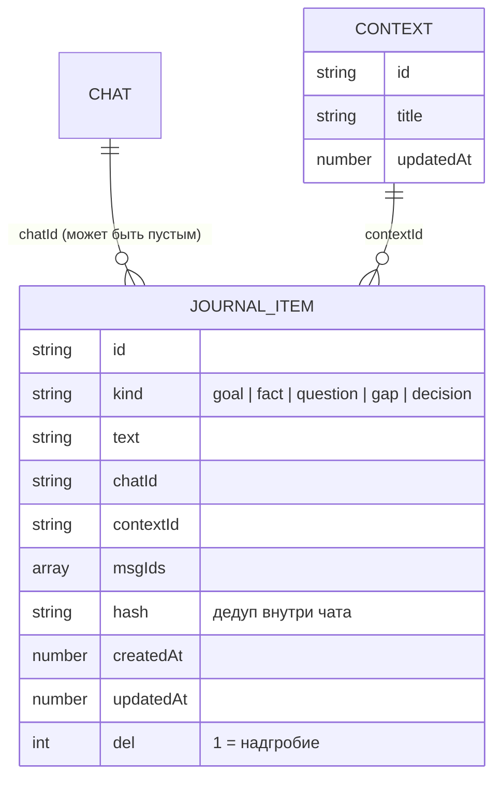
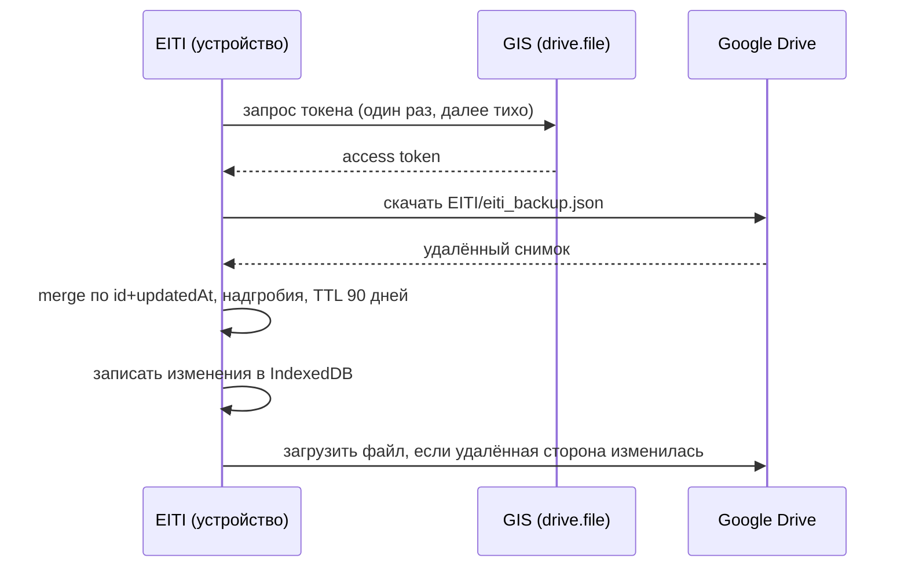
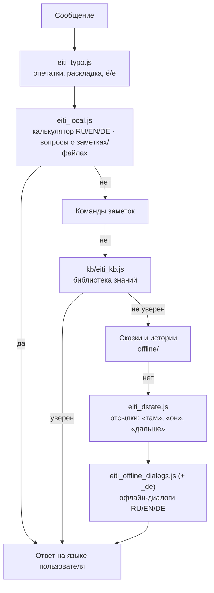
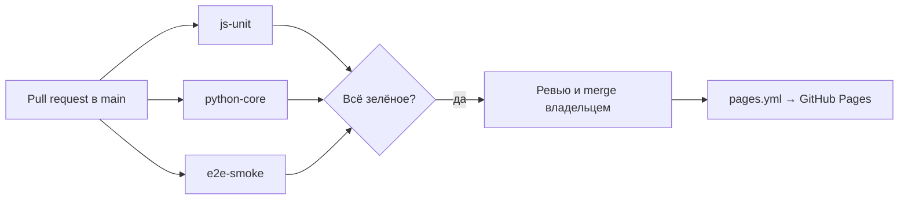

# 🏛️ Архитектура VELANTRIM EITI (v14.10.0)

> Этот документ описывает, как устроено приложение изнутри: какие файлы за что отвечают, где лежат данные, как работает офлайн-режим, синхронизация, голос, кеширование и как выпускается релиз.
> Краткая инструкция для агентов и разработчиков — в [AGENTS.md](../AGENTS.md); ограничения платформы PWA — в [docs/PWA_LIMITS.md](PWA_LIMITS.md).

## Содержание

1. [Общая схема](#1-общая-схема)
2. [Структура файлов](#2-структура-файлов)
3. [Хранилище: IndexedDB `eiti_v4` v17](#3-хранилище-indexeddb-eiti_v4-v17)
4. [Модель дневника](#4-модель-дневника-journal--contexts)
5. [Синхронизация с Google Drive](#5-синхронизация-с-google-drive)
6. [Офлайн-конвейер ответа](#6-офлайн-конвейер-ответа)
7. [Голос: Grok Voice и Gemini Live](#7-голос-grok-voice-и-gemini-live)
8. [Service Worker и кеширование](#8-service-worker-и-кеширование)
9. [Интерфейс и языки (RU / EN / DE)](#9-интерфейс-и-языки-ru--en--de)
10. [Тесты и CI](#10-тесты-и-ci)
11. [Процесс релиза](#11-процесс-релиза)

---

## 1. Общая схема

EITI — полностью клиентское PWA. Нет backend, нет сборки: GitHub Pages раздаёт статические файлы, всё остальное происходит в браузере.


| Принцип | Что это значит |
|---|---|
| **Один файл UI** | Почти вся логика интерфейса — в `index.html` (~3.8 МБ). Правки — точечные. |
| **Без сборки** | Модули в `local/`, `kb/`, `offline/` — обычные UMD-файлы, работают и в браузере, и в Node-тестах. |
| **Данные у пользователя** | Источник истины — IndexedDB. Ключи API лежат в localStorage и уходят только напрямую провайдеру. |
| **Офлайн по умолчанию** | Без сети отвечают локальные слои: калькулятор, заметки, библиотека знаний, диалоги и сказки. |

## 2. Структура файлов

```text
.
├── index.html              # приложение: UI, IDB, память, провайдеры, голос, Drive, i18n
├── sw.js                   # Service Worker: кеши CORE и offline
├── manifest.json           # манифест PWA
├── sql-wasm.js / .wasm     # SQLite (sql.js) для поискового индекса
├── data/                   # справочные данные (SWR-кеш)
├── local/                  # офлайн-движки «EITI Local»
│   ├── eiti_local.js       #   калькулятор RU/EN/DE + вопросы о своих данных
│   ├── eiti_typo.js        #   опечатки и раскладка (+ eiti_typo_vocab.json)
│   ├── eiti_dstate.js      #   память диалога: слоты, стек тем, отсылки
│   ├── eiti_journal.js     #   дневник: записи, дедуп, миграция
│   └── eiti_drive_sync.js  #   слияние для синхронизации с Drive
├── kb/                     # библиотека знаний (~29 тыс. статей)
│   ├── eiti_kb.js          #   движок поиска (BM25 + алиасы + леммы + транслит)
│   ├── build_kb.py         #   сборка idx/ и packs/ из src/
│   ├── src/*.txt           #   исходники; w_*.txt генерируются из Wikidata
│   └── tests/heldout*.txt  #   отложенные наборы для оценки качества
├── offline/                # офлайн-диалоги и сказки (RU/EN + слой DE)
├── docs/                   # документация (этот файл, PWA_LIMITS.md, …)
├── velantrim_core/
│   ├── tests_js/           # node --test (чистая логика)
│   ├── tests/              # pytest (версии, сборка KB, связки)
│   └── e2e/                # Playwright (настоящий браузер)
└── .github/workflows/      # test.yml (CI), pages.yml (деплой)
```

## 3. Хранилище: IndexedDB `eiti_v4` v17

База открывается как `indexedDB.open('eiti_v4', 17)`. При обновлении версии из другой вкладки приложение закрывает соединение и просит перезапуск.

| Store | Ключ | Что хранит |
|---|---|---|
| `chats` | `id` | Чаты: заголовок, сообщения, даты |
| `messages` | `id` | Отдельные сообщения (L1-история) |
| `notes` | `id` | Заметки (Markdown, папки) |
| `note_history` | автоинкремент | Версии заметок |
| `files` | `name` | Файлы пользователя |
| `tasks` | автоинкремент | Задачи (`[TASK_ADD:…]`) |
| `reminders` | `id` | Напоминания |
| `kb` | `id` | Личная база знаний с эпистемическими статусами |
| `kb_vectors` | `id` | Эмбеддинги KB |
| `memory` | `id` | Долгосрочная память |
| `l2` | `chatId` | Дайджесты прошлых сессий |
| `l3` | `id` | Автоизвлечённый профиль |
| `reasoning` | `id` | MOSC-граф, `journal_meta`, `daily_log:*` |
| `pkg` / `pkg_edges` | `id` | Хеббианский граф знаний |
| `lemma` | `k` | Кеш лемм |
| `tts_cache` | `id` | Кеш озвучки |
| `backups` | `id` | Локальные резервные копии |
| **`journal`** | `id` | **Дневник: одна запись на пункт** (индексы `chatId`, `contextId`, `kind`, `updatedAt`) |
| **`contexts`** | `id` | **Темы дневника** |

`localStorage` хранит тему, флаги UI, язык интерфейса, API-ключи и совместимые ключи профиля. SQLite WASM — только производный индекс: его можно перестроить из IDB в любой момент.

## 4. Модель дневника (`journal` + `contexts`)



- **Дедуп** — по хешу нормализованного текста внутри одного чата.
- **Удаление** — метка `del:1` (надгробие), поэтому удалённое не «воскресает» при синхронизации. Удаление чата отвязывает его пункты (`chatId` очищается), но не удаляет их.
- **Миграция** со старого blob `eiti_rne_data_v1` выполняется один раз и идемпотентно; копия остаётся как `eiti_rne_data_v1_bak`.
- **Контекст для ИИ** (`eitiJournalForAI`): сначала текущий чат, затем его тема, затем остальное.
- Режимы отображения: «отдельный для каждого чата», «по датам» (по `updatedAt`), «умный» (по темам).

## 5. Синхронизация с Google Drive

| Параметр | Значение |
|---|---|
| Авторизация | Google Identity Services (token client), scope **`drive.file`** — приложение видит только свои файлы |
| Файл | `EITI/eiti_backup.json` |
| Client ID | константа `EITI_GOOGLE_CLIENT_ID` в `index.html` — в репозитории это **пустая заглушка**, владелец развёртывания вписывает свой OAuth Client ID |
| Слияние | `local/eiti_drive_sync.js`: по каждой записи **`id` + `updatedAt`** (побеждает более поздняя) |
| Удаления | надгробия, удаляются через **90 дней** (`TOMBSTONE_TTL`) |
| Настройки | сливаются по ключам; **ключи API и токены никогда не синхронизируются** |
| Stores | включая `journal` и `contexts` (`SYNC_STORES`) |



## 6. Офлайн-конвейер ответа

Когда нет ключа или сети, сообщение проходит цепочку локальных слоёв. Первый уверенный ответ побеждает.



### Калькулятор (`local/eiti_local.js`)

| Язык | Примеры |
|---|---|
| RU | «сколько будет двести плюс три», «половина от 50», «корень из 16», «2,5 умножить на 4» |
| EN | «what is twenty-five times four», «half of 50», «a hundred divided by 8», «square root of 81», «2 to the power of 10» |
| DE | «was ist zweiundzwanzig plus drei», «die Hälfte von 50», «hundert geteilt durch 8», «2,5 mal 4», «Wurzel aus 81» |

Безопасный разбор (рекурсивный спуск, без `eval`). Число-слова читаются функциями `readInt`/`readNumber`, немецкие составные числа разбиваются `deSplit`. Язык ответа — язык приложения или, если он не задан, определяется по словам сообщения (`langHint`); формат числа соответствует языку (`2,5` / `20.000` в DE, `2.5` / `20,000` в EN).

### Библиотека знаний (`kb/eiti_kb.js`)

- Инвертированный индекс по триггерам и ключам, BM25-подобный скоринг по основам слов + бонус за точное совпадение.
- **Леммы** (`lem`): русские падежные окончания снимаются при точном сравнении — «Наполеона», «о Наполеоне» → «наполеон».
- **Алиасы** (`ALIAS`): аббревиатуры и написания — `мгу`, `мфти`, `сша`, `ссср`, `эппл → apple`, `гугл` и др.
- **Транслитерация** (`translit`): «napoleon» ↔ «наполеон» — подставляется, только если исходное слово не найдено в индексе, а транслит найден.
- `confident()` решает, достаточно ли хорош первый результат, чтобы ответить напрямую.
- Сборка: `python3 kb/build_kb.py --strict`. Файлы `kb/src/w_*.txt` генерируются, руками их не правят; ручной триггер побеждает сгенерированный дубликат.

## 7. Голос: Grok Voice и Gemini Live

| | Grok Voice | Gemini Live |
|---|---|---|
| Статус | **по умолчанию** | по выбору |
| Где выбрать | Настройки → «Голосовой ассистент» | то же |
| Ключ | xAI | Google AI Studio |
| Микрофон | PCM 16 кГц (на iPhone пересэмплирование, AudioContext создаётся в обработчике нажатия) | то же |

Провайдеры зарегистрированы в `window.EitiVoice` (`grok` | `gemini`), кнопка голоса подписана выбранным. Без ключа или при обрыве — тост с кнопкой «Переключить на …».

## 8. Service Worker и кеширование

| Кеш | Имя | Стратегия |
|---|---|---|
| CORE | `eiti-v14.10.0` | precache `index.html`, `local/*`, офлайн-модули, иконки; лимит 24 записи (`swTrimCache`) |
| Офлайн-пакеты | `eiti-offline-v14.10.0` | `offline/**`, `kb/**`: cache-first + фоновое обновление, без лимита |
| `data/*.json` | — | stale-while-revalidate |

При активации старые кеши удаляются, клиентам отправляется `SW_UPDATED` с версией — приложение предлагает перезагрузку.

## 9. Интерфейс и языки (RU / EN / DE)

- Исходные строки интерфейса — на русском. `window.EITI_I18N` хранит словари `DICT` (en, de), обратные словари `REV`, функции `walkAndTranslate` / `walkAndTranslateAttrs` (текст, `placeholder`, `title`, `aria-label`) и `tr()` для динамических строк; новые словари добавляются через `addDict`.
- `MutationObserver` переводит то, что появилось позже; тосты переводятся сразу в `showToast`, без мигания русского текста.
- Динамические строки вида «Префикс: значение» переводятся по префиксу.
- Пользовательский контент (сообщения, заметки) не переводится; элементы с `data-i18n-skip` пропускаются.
- Тест `velantrim_core/e2e/v14100_ui.spec.js` переключает EN и DE и проверяет, что на экранах «Чат», «Дневник», «История», «Плеер», «Файлы», «Заметки», «Настройки» не осталось кириллицы.

### Сообщения в чате

Под каждым сообщением — **один** компактный ряд иконок (🔊 📋 ✏️ 🗑) в строке со временем и Trace: приглушённые, ≥ 32 px для пальца, работают в RTL. Пустое поле ввода — в одну строку («Сообщение…» / «Message…» / «Nachricht…»), растёт до ~6 строк, затем прокручивается; после отправки сжимается обратно.

## 10. Тесты и CI

| Уровень | Команда | Что проверяет |
|---|---|---|
| Node | `node --test velantrim_core/tests_js/*.test.js` | чистая логика: калькулятор (`calc_multilang.test.js`), KB, дневник, Drive-merge, опечатки |
| pytest | `cd velantrim_core && pip install -r requirements.txt && pytest tests/` | синхронность версий, сборка KB идентична пересборке, связки в `index.html` |
| Playwright | `cd velantrim_core/e2e && npm ci && npx playwright install chromium && npx playwright test --project=chromium` | реальный браузер: офлайн-ответы, языки, дневник, Drive (моки), UI сообщений |



**Детерминированные e2e.** Тесты ждут явного флага `window.eitiChatReady === true` (ставится после `eitiPatchSendButton()`, когда настоящий обработчик отправки установлен), а ответ считается готовым, когда исчез индикатор набора и текст не меняется между двумя опросами. Никаких фиксированных `waitForTimeout` для синхронизации.

## 11. Процесс релиза

1. Ветка `feat/vX.Y.Z` от `origin/main`.
2. Версия обновляется **везде одновременно**: `EITI_VERSION` в `index.html`, `CACHE` / `OFFLINE_CACHE` / `SW_UPDATED` в `sw.js`, `description` в `manifest.json`, бейдж и раздел «Что нового» в `README.md`, строка в `AGENTS.md`. Это проверяют `audit_remediation.test.js` и `tests/test_vXYZ.py` (старый тест версии переименовывается в `test_version_sync_moved`).
3. Изменения KB — только через `kb/src/*.txt` и `build_kb.py --strict`.
4. Все три уровня тестов локально → PR в `main` → CI зелёный → merge владельцем → автодеплой на GitHub Pages.
5. Новые платформенные ограничения — в [docs/PWA_LIMITS.md](PWA_LIMITS.md).
