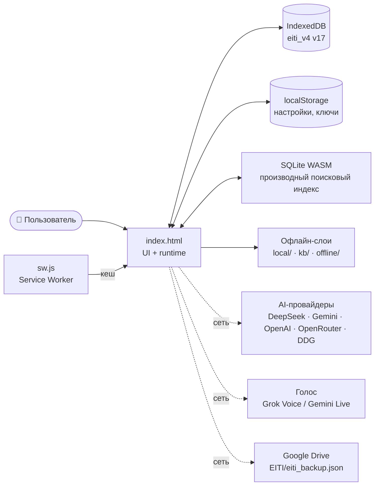
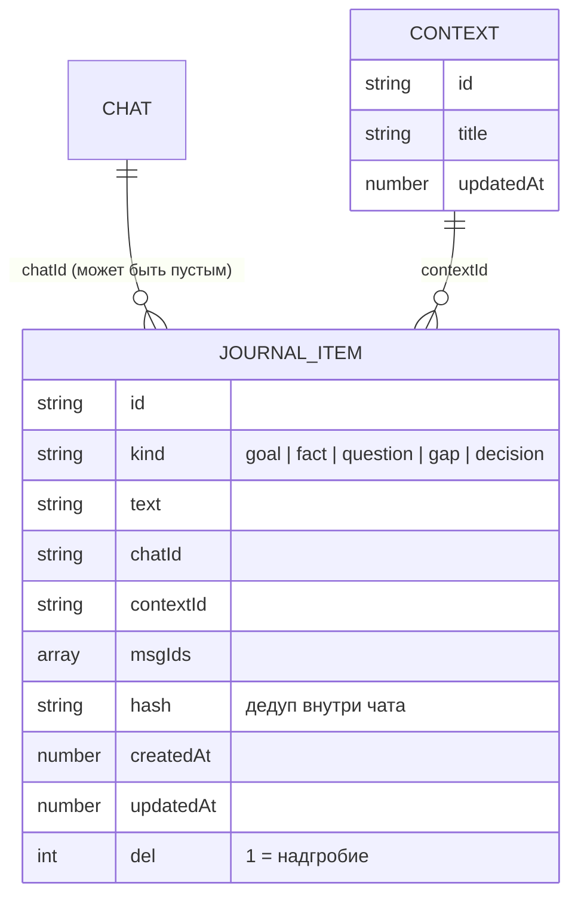
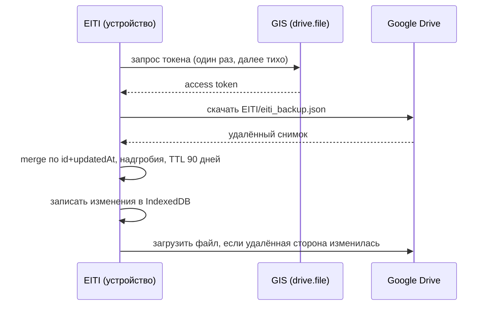
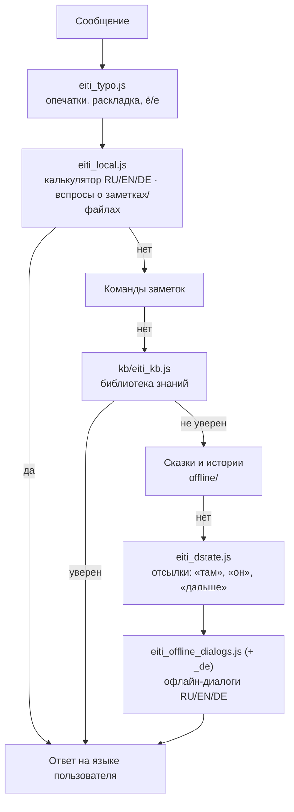
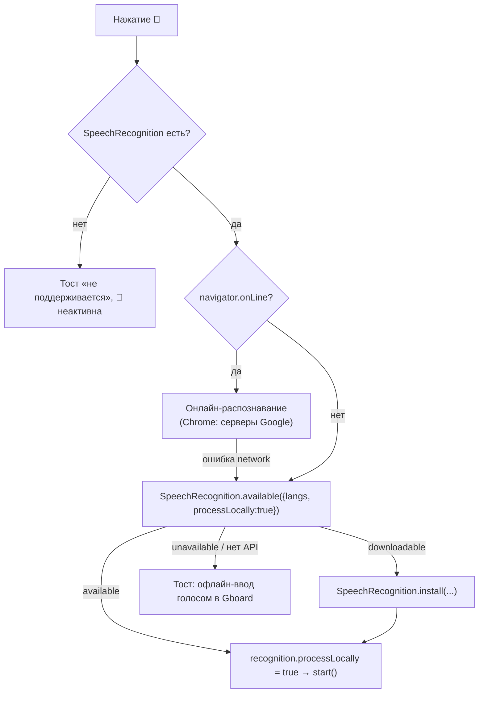
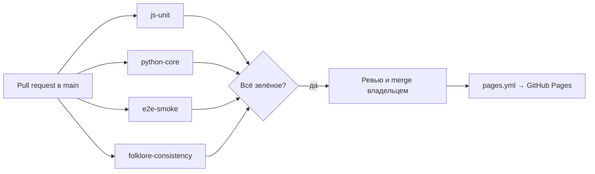

# 🏛️ Архитектура VELANTRIM EITI (v14.13.0)

> Этот документ описывает, как устроено приложение изнутри: какие файлы за что отвечают, где лежат данные, как работает офлайн-режим, синхронизация, голос, кеширование и как выпускается релиз.
> Краткая инструкция для агентов и разработчиков — в [AGENTS.md](../AGENTS.md); ограничения платформы PWA — в [docs/PWA_LIMITS.md](PWA_LIMITS.md).

## Содержание

1. [Общая схема](#1-общая-схема)
2. [Структура файлов](#2-структура-файлов)
3. [Хранилище: IndexedDB `eiti_v4` v17](#3-хранилище-indexeddb-eiti_v4-v17)
4. [Модель дневника](#4-модель-дневника-journal--contexts)
5. [Синхронизация с Google Drive](#5-синхронизация-с-google-drive)
6. [Офлайн-конвейер ответа](#6-офлайн-конвейер-ответа)
7. [Голос: Grok Voice и Gemini Live](#7-голос-grok-voice-и-gemini-live)
8. [Service Worker и кеширование](#8-service-worker-и-кеширование)
9. [Интерфейс и языки (RU / EN / DE)](#9-интерфейс-и-языки-ru--en--de)
10. [Тесты и CI](#10-тесты-и-ci)
11. [Процесс релиза](#11-процесс-релиза)
12. [Полная карта хранения данных](#12-полная-карта-хранения-данных)
13. [Экспорт / импорт](#13-экспорт--импорт-eitiarchiveexport--eitiarchiveimport)
14. [Синхронизация (подробно)](#14-синхронизация-подробно)
15. [PWA и офлайн (подробно)](#15-pwa-и-офлайн-подробно)
16. [Сборка, инструменты и CI](#16-сборка-инструменты-и-ci)
17. [Что публикуется на GitHub Pages](#17-что-публикуется-на-github-pages)
18. [Перенос в нативное приложение](#18-перенос-в-нативное-приложение)

---

## 1. Общая схема

EITI — полностью клиентское PWA. Нет backend, нет сборки: GitHub Pages раздаёт статические файлы, всё остальное происходит в браузере.



| Принцип | Что это значит |
|---|---|
| **Один файл UI** | Почти вся логика интерфейса — в `index.html` (~3.8 МБ). Правки — точечные. |
| **Без сборки** | Модули в `local/`, `kb/`, `offline/` — обычные UMD-файлы, работают и в браузере, и в Node-тестах. |
| **Данные у пользователя** | Источник истины — IndexedDB. Ключи API лежат в localStorage и уходят только напрямую провайдеру. |
| **Офлайн по умолчанию** | Без сети отвечают локальные слои: калькулятор, заметки, библиотека знаний, диалоги и сказки. |

## 2. Структура файлов

```text
.
├── index.html              # приложение: UI, IDB, память, провайдеры, голос, Drive, i18n
├── sw.js                   # Service Worker: кеши CORE и offline
├── manifest.json           # манифест PWA
├── sql-wasm.js / .wasm     # SQLite (sql.js) для поискового индекса
├── data/                   # справочные данные (SWR-кеш)
├── local/                  # офлайн-движки «EITI Local»
│   ├── eiti_local.js       #   калькулятор RU/EN/DE + вопросы о своих данных
│   ├── eiti_typo.js        #   опечатки и раскладка (+ eiti_typo_vocab.json)
│   ├── eiti_dstate.js      #   память диалога: слоты, стек тем, отсылки
│   ├── eiti_journal.js     #   дневник: записи, дедуп, миграция
│   ├── eiti_related.js     #   «Похожие / Рассуждение»: похожие заметки (TF-IDF), карточки, настройки
│   └── eiti_drive_sync.js  #   слияние для синхронизации с Drive
├── kb/                     # библиотека знаний (~29 тыс. статей)
│   ├── eiti_kb.js          #   движок поиска (BM25 + алиасы + леммы + транслит)
│   ├── build_kb.py         #   сборка idx/ и packs/ из src/
│   ├── src/*.txt           #   исходники; w_*.txt генерируются из Wikidata
│   └── tests/heldout*.txt  #   отложенные наборы для оценки качества
├── offline/                # офлайн-диалоги и сказки (RU/EN + слой DE)
├── docs/                   # документация (этот файл, PWA_LIMITS.md, …)
├── velantrim_core/
│   ├── tests_js/           # node --test (чистая логика)
│   ├── tests/              # pytest (версии, сборка KB, связки)
│   └── e2e/                # Playwright (настоящий браузер)
└── .github/workflows/      # test.yml (CI), pages.yml (деплой)
```

## 3. Хранилище: IndexedDB `eiti_v4` v17

База открывается как `indexedDB.open('eiti_v4', 17)`. При обновлении версии из другой вкладки приложение закрывает соединение и просит перезапуск.

| Store | Ключ | Что хранит |
|---|---|---|
| `chats` | `id` | Чаты: заголовок, сообщения, даты |
| `messages` | `id` | Отдельные сообщения (L1-история) |
| `notes` | `id` | Заметки (Markdown, папки) |
| `note_history` | автоинкремент | Версии заметок |
| `files` | `name` | Файлы пользователя |
| `tasks` | автоинкремент | Задачи (`[TASK_ADD:…]`) |
| `reminders` | `id` | Напоминания |
| `kb` | `id` | Личная база знаний с эпистемическими статусами |
| `kb_vectors` | `id` | Эмбеддинги KB |
| `memory` | `id` | Долгосрочная память |
| `l2` | `chatId` | Дайджесты прошлых сессий |
| `l3` | `id` | Автоизвлечённый профиль |
| `reasoning` | `id` | MOSC-граф, `journal_meta`, `daily_log:*` |
| `pkg` / `pkg_edges` | `id` | Хеббианский граф знаний |
| `lemma` | `k` | Кеш лемм |
| `tts_cache` | `id` | Кеш озвучки |
| `backups` | `id` | Локальные резервные копии |
| **`journal`** | `id` | **Дневник: одна запись на пункт** (индексы `chatId`, `contextId`, `kind`, `updatedAt`) |
| **`contexts`** | `id` | **Темы дневника** |

`localStorage` хранит тему, флаги UI, язык интерфейса, API-ключи и совместимые ключи профиля. SQLite WASM — только производный индекс: его можно перестроить из IDB в любой момент. Полная таблица stores (с индексами), ключей localStorage и слоёв памяти — в [§12](#12-полная-карта-хранения-данных); после #48 добавляется store `memkv` (БД v18).

## 4. Модель дневника (`journal` + `contexts`)



- **Дедуп** — по хешу нормализованного текста внутри одного чата.
- **Удаление** — метка `del:1` (надгробие), поэтому удалённое не «воскресает» при синхронизации. Удаление чата отвязывает его пункты (`chatId` очищается), но не удаляет их.
- **Миграция** со старого blob `eiti_rne_data_v1` выполняется один раз и идемпотентно; копия остаётся как `eiti_rne_data_v1_bak`.
- **Контекст для ИИ** (`eitiJournalForAI`): сначала текущий чат, затем его тема, затем остальное.
- Режимы отображения: «отдельный для каждого чата», «по датам» (по `updatedAt`), «умный» (по темам).

## 5. Синхронизация с Google Drive

| Параметр | Значение |
|---|---|
| Авторизация | Google Identity Services (token client), scope **`drive.file`** — приложение видит только свои файлы |
| Файл | `EITI/eiti_backup.json` |
| Client ID | константа `EITI_GOOGLE_CLIENT_ID` в `index.html` — в репозитории это **пустая заглушка**, владелец развёртывания вписывает свой OAuth Client ID |
| Слияние | `local/eiti_drive_sync.js`: по каждой записи **`id` + `updatedAt`** (побеждает более поздняя) |
| Удаления | надгробия, удаляются через **90 дней** (`TOMBSTONE_TTL`) |
| Настройки | сливаются по ключам; **ключи API и токены никогда не синхронизируются** |
| Stores | включая `journal` и `contexts` (`SYNC_STORES`) |



## 6. Офлайн-конвейер ответа

Когда нет ключа или сети, сообщение проходит цепочку локальных слоёв. Первый уверенный ответ побеждает.



### Калькулятор (`local/eiti_local.js`)

| Язык | Примеры |
|---|---|
| RU | «сколько будет двести плюс три», «половина от 50», «корень из 16», «2,5 умножить на 4» |
| EN | «what is twenty-five times four», «half of 50», «a hundred divided by 8», «square root of 81», «2 to the power of 10» |
| DE | «was ist zweiundzwanzig plus drei», «die Hälfte von 50», «hundert geteilt durch 8», «2,5 mal 4», «Wurzel aus 81» |

Безопасный разбор (рекурсивный спуск, без `eval`). Число-слова читаются функциями `readInt`/`readNumber`, немецкие составные числа разбиваются `deSplit`. Язык ответа — язык приложения или, если он не задан, определяется по словам сообщения (`langHint`); формат числа соответствует языку (`2,5` / `20.000` в DE, `2.5` / `20,000` в EN).

### Библиотека знаний (`kb/eiti_kb.js`)

- Инвертированный индекс по триггерам и ключам, BM25-подобный скоринг по основам слов + бонус за точное совпадение.
- **Леммы** (`lem`): русские падежные окончания снимаются при точном сравнении — «Наполеона», «о Наполеоне» → «наполеон».
- **Алиасы** (`ALIAS`): аббревиатуры и написания — `мгу`, `мфти`, `сша`, `ссср`, `эппл → apple`, `гугл` и др.
- **Транслитерация** (`translit`): «napoleon» ↔ «наполеон» — подставляется, только если исходное слово не найдено в индексе, а транслит найден.
- `confident()` решает, достаточно ли хорош первый результат, чтобы ответить напрямую.
- Сборка: `python3 kb/build_kb.py --strict`. Файлы `kb/src/w_*.txt` генерируются, руками их не правят; ручной триггер побеждает сгенерированный дубликат.

## 7. Голос: Grok Voice и Gemini Live

| | Grok Voice | Gemini Live |
|---|---|---|
| Статус | **по умолчанию** | по выбору |
| Где выбрать | Настройки → «Голосовой ассистент» | то же |
| Ключ | xAI | Google AI Studio |
| Микрофон | PCM 16 кГц (на iPhone пересэмплирование, AudioContext создаётся в обработчике нажатия) | то же |

Ассистент запускается из меню **«+»** (пункт «🗣️ Голосовой ассистент» с подписью провайдера и ссылкой «изменить» → `eitiOpenVoiceSettings()`, открывает и подсвечивает Настройки → AI → «Голосовой ассистент»; та же ссылка — в меню типа дневника). Провайдеры зарегистрированы в `window.EitiVoice` (`grok` | `gemini`), кнопка голоса подписана выбранным. Без ключа или при обрыве — тост с кнопкой «Переключить на …».

### Голосовой ввод (🎤 в поле сообщения)

Это не ассистент, а диктовка текста в поле (`eitiDictationToggle`). Сообщение само не отправляется.



| Параметр | Значение |
|---|---|
| Язык | по языку приложения: `ru-RU`, `en-US`, `de-DE` |
| Результаты | `interimResults` — текст виден по мере речи; финальный остаётся, к уже набранному тексту дописывается |
| Состояние | пульсирующая золотая кнопка, `aria-pressed`, подпись «Остановить запись» |
| Ошибки | `not-allowed`, `no-speech`, `network`, `audio-capture`, `language-not-supported` → переведённые тосты |
| Тест | `velantrim_core/e2e/v14100_dictation.spec.js` (SpeechRecognition замокан, оба пути — онлайн и на устройстве) |

## 8. Service Worker и кеширование

| Кеш | Имя | Стратегия |
|---|---|---|
| CORE | `eiti-v14.13.0` | precache `index.html`, `local/*`, офлайн-модули, иконки; лимит 24 записи (`swTrimCache`) |
| Офлайн-пакеты | `eiti-offline-v14.11.0` | `offline/**`, `kb/**`: cache-first + фоновое обновление, без лимита |
| `data/*.json` | — | stale-while-revalidate |

При активации старые кеши удаляются, клиентам отправляется `SW_UPDATED` с версией — приложение предлагает перезагрузку.

## 9. Интерфейс и языки (RU / EN / DE)

- Исходные строки интерфейса — на русском. `window.EITI_I18N` хранит словари `DICT` (en, de), обратные словари `REV`, функции `walkAndTranslate` / `walkAndTranslateAttrs` (текст, `placeholder`, `title`, `aria-label`) и `tr()` для динамических строк; новые словари добавляются через `addDict`.
- `MutationObserver` переводит то, что появилось позже; тосты переводятся сразу в `showToast`, без мигания русского текста.
- Динамические строки вида «Префикс: значение» переводятся по префиксу.
- Пользовательский контент (сообщения, заметки) не переводится; элементы с `data-i18n-skip` пропускаются.
- Тест `velantrim_core/e2e/v14100_ui.spec.js` переключает EN и DE и проверяет, что на экранах «Чат», «Дневник», «История», «Плеер», «Файлы», «Заметки», «Настройки» не осталось кириллицы.

### Сообщения в чате

Под каждым сообщением — **один** компактный ряд иконок (🔊 📋 ✏️ 🗑) в строке со временем и Trace: приглушённые, ≥ 32 px для пальца, работают в RTL. Пустое поле ввода — в одну строку («Сообщение…» / «Message…» / «Nachricht…»), растёт до ~6 строк, затем прокручивается; после отправки сжимается обратно.

## 10. Тесты и CI

| Уровень | Команда | Что проверяет |
|---|---|---|
| Node | `node --test velantrim_core/tests_js/*.test.js` | чистая логика: калькулятор (`calc_multilang.test.js`), KB, дневник, Drive-merge, опечатки |
| pytest | `cd velantrim_core && pip install -r requirements.txt && pytest tests/` | синхронность версий, сборка KB идентична пересборке, связки в `index.html` |
| Playwright | `cd velantrim_core/e2e && npm ci && npx playwright install chromium && npx playwright test --project=chromium` | реальный браузер: офлайн-ответы, языки, дневник, Drive (моки), UI сообщений |



**Детерминированные e2e.** Тесты ждут явного флага `window.eitiChatReady === true` (ставится после `eitiPatchSendButton()`, когда настоящий обработчик отправки установлен), а ответ считается готовым, когда исчез индикатор набора и текст не меняется между двумя опросами. Никаких фиксированных `waitForTimeout` для синхронизации.

## 11. Процесс релиза

1. Ветка `feat/vX.Y.Z` от `origin/main`.
2. Версия обновляется **везде одновременно**: `EITI_VERSION` в `index.html`, `CACHE` / `OFFLINE_CACHE` / `SW_UPDATED` в `sw.js`, `description` в `manifest.json`, бейдж и раздел «Что нового» в `README.md`, строка в `AGENTS.md`. Это проверяют `audit_remediation.test.js` и `tests/test_vXYZ.py` (старый тест версии переименовывается в `test_version_sync_moved`).
3. Изменения KB — только через `kb/src/*.txt` и `build_kb.py --strict`.
4. Все три уровня тестов локально → PR в `main` → CI зелёный → merge владельцем → автодеплой на GitHub Pages.
5. Новые платформенные ограничения — в [docs/PWA_LIMITS.md](PWA_LIMITS.md).

---

> Разделы 12–18 добавлены как **полное описание конструкции** приложения для будущего переноса в нативное приложение. Всё выведено из кода (`index.html`, `local/*.js`, `sw.js`, `.github/workflows/*`) на `main` @ a5708b9; имена функций и ключей — как в коде. Пометка **«после #N»** означает изменение из открытого PR, ещё не слитого в `main`.

## 12. Полная карта хранения данных

### 12.1 Где что лежит

| Слой | Технология | Источник истины? | Что хранит |
|---|---|---|---|
| Основные данные | IndexedDB `eiti_v4` (v17; **v18 после #48**) | **да** | чаты, сообщения, заметки, файлы, KB, L2, L3, дневник, граф, бэкапы |
| Офлайн-кэш движков | IndexedDB `eiti_offline` v1, store `kv` | нет (кэш) | разобранные офлайн-пакеты / состояние офлайн-диалогов (`kv(mode,key,val)` в `EitiOffline`) |
| Поисковый индекс | SQLite WASM (`sql-wasm.js/.wasm`, sql.js) | нет (производный) | FTS5 (`chat_history_fts`, `kb_idx`, `audit_log`); сериализуется `_persistSQL()` в IDB `files` под именем `__sql_db__` |
| Настройки и флаги | localStorage | да, для настроек | тема, язык, провайдеры, модели, флаги UI, ключи API, короткий профиль |
| Кэши SW | Cache Storage | нет | `eiti-v<ver>` (CORE), `eiti-offline-v<ver>` (offline/kb) |

### 12.2 IndexedDB `eiti_v4` — все stores (`eitiInit` → `onupgradeneeded`)

| Store | keyPath | Индексы | Запись (пример) | Кто пишет |
|---|---|---|---|---|
| `chats` | `id` | `updated` | `{id,title,created,updated,…}` | `eitiSaveChat`/чат |
| `messages` | `id` | `chat_id` | `{id,chat_id,role,content,ts}` (L1) | отправка сообщений |
| `files` | `name` | `updated` | `{name,data,updated}`; также `__sql_db__` | Файлы, `_persistSQL` |
| `notes` | `id` | `updated` | `{id,title,body,folder,updated,…}` | `notesSave` |
| `note_history` | `id` (autoInc) | `note_id`, `ts` | версии заметок | редактор заметок |
| `l2` | `chatId` | — | дайджест сессии `{chatId,title,digest,…}` | L2-дайджесты |
| `l3` | `id` (= категория: `name`, `city`, `goal`…) | — | `{id,label,value,source,ts}`; **после #49:** + `correction_history[]` | `_l3Save` |
| `kb` | `id` | — | факт KB с `epistemic_state`, `confidence`, `memory_layer` | `eitiKBSaveAsync` |
| `kb_vectors` | `id` | — | эмбеддинги | RAG |
| `memory` | `id` | `created`, `tag` | `{id,text,tag,created,source:'user'|'ai'}` (`[MEM_ADD]`) | долгосрочная память |
| `reasoning` | `id` | — | MOSC-граф, `journal_meta`, `daily_log:*` | MOSC, дневник |
| `pkg` / `pkg_edges` | `id` | `weight`,`concept`,`category` | Хеббианский граф | `pkgLoadAndDecay` |
| `lemma` | `k` | — | кэш лемм | `eitiLemmaInitIDB` |
| `tasks` | `id` (autoInc) | `status`,`priority`,`due_date` | задачи `[TASK_ADD:…]` | задачи |
| `reminders` | `id` | `ts` | напоминания | напоминания |
| `tts_cache` | `id` | `chatId`, `ts` | кэш озвучки | TTS |
| `backups` | `id` | — | `latest` (локальная копия); **после #48:** `mem_ls_migration_v1` | бэкапы, миграция |
| `journal` | `id` | `chatId`,`contextId`,`kind`,`updatedAt` | пункт дневника (`del:1` — надгробие) | `local/eiti_journal.js` |
| `contexts` | `id` | — | темы дневника | дневник |
| **`memkv`** *(после #48)* | `k` | — | `{k:'learned'|'archive', v:[…], updatedAt}` — выученные факты и архив | `eitiLearnSave` |

Правила: версию БД поднимать только вместе с новым store; при `onversionchange` соединение закрывается и пользователь просит перезапуск; `onblocked` → тост + повтор через 2 с.

### 12.3 localStorage — ключи и бюджет

Бюджет: localStorage ≈ 5 МБ на origin и **синхронный** (блокирует UI), поэтому сюда — только маленькое (цель: чистый профиль < 100 КБ, измеряет `l3_audit_contract.spec.js`; сейчас ≈ 1.6 КБ).

| Группа | Ключи (основные) | Размер | Синхронизация Drive |
|---|---|---|---|
| Секреты | `deepseek_api_key`, `eiti_gemini_key`, `eiti_grok_key`, `eiti_or_key`, `openrouter_api_key`, `eiti_openai_key`, `eiti_mistral_key`, `eiti_qwen_key`, `eiti_tavily_key`, `eiti_tts_*_key`, `eiti_apikey_*`, `eiti_emb_key_*`, `eiti_crypto_salt` | байты | **никогда** (`SECRET_RE`) |
| Провайдеры/модели | `eiti_ai_provider`, `eiti_api_provider`, `eiti_*_model`, `eiti_search_provider`, `eiti_voice_provider`, `eiti_tts_*`, `eiti_grok_voice*`, `eiti_gemini_live_*` | байты | да |
| UI и вид | `theme`, `eiti_locale`, `velantrim_messenger_ui_v1`, `eiti_hidden_tabs`, `eiti_icon_*`, `eiti_chat_bg_preset`, `eiti_player_*`, `*_cols`, `eiti_header_hidden` | байты | да |
| Поведение | `eiti_offline_mode`, `eiti_only_ai`, `eiti_cog_mode`, `eiti_rag_*`, `eiti_retrieval_cfg`, `eiti_strict_memory_mode`, `eiti_mosc_*`, `eiti_notes_ai_*`, `eiti_files_*`, `eiti_related_show`, `eiti_reasoning_*`, `eiti_save_to_note`, `eiti_save_target` | байты | да |
| Онбординг/флаги | `eiti_onboarded`, `eiti_toured_v7`, `eiti_first_run_done_v1*`, `eiti_pwa_installed`, `eiti_storage_persistent*`, `eiti_keys_migrated_v1`, `eiti_daily_idb_migrated_v1`, `eiti_has_backup`, **`eiti_mem_migrated_v1`** *(после #48)* | байты | да |
| Профиль (короткий) | `eiti_user_profile_v1`, `eiti_ai_instructions`, `eiti_system_desc_v1`, `eiti_user_intents_v1` | ≤ ~10 КБ | да |
| Выученные факты | `eiti_learned_v1` (≤ 200), `eiti_learned_archive_v1` (≤ 500) | до ~100 КБ и ~230 КБ ⚠ | да (как настройки, до #48) |
| После #48 | эти два ключа переезжают в IDB `memkv` и удаляются из LS при следующем успешном запуске | 0 | через `SYNC_STORES.memkv` |
| Наследие / мигрируется | `eiti_kb_v1`/`eiti_kb` → IDB `kb`; `eiti_vb_patterns` → IDB; `eiti_rne_data_v1` → `journal` (копия `_bak`); `velantrim_notes_v1` (NOTES_KEY) — старые заметки | разное | — |
| Крупное исключение | `eiti_chat_bg_image` (data-URL фона), `eiti_qwen_clone_audio` | до сотен КБ ⚠ | `filterSettings` отбрасывает значения > 256 КБ |
| Повреждённые данные *(после #47)* | `<key>.corrupt.<ts>` — исходная строка испорченного JSON | как исходник | да (проверьте при переносе) |

Секреты не синхронизируются и не экспортируются в Drive; они уходят только напрямую провайдеру.

### 12.4 Слои памяти

| Слой | Где | Что | В промпт ИИ |
|---|---|---|---|
| **L1** | IDB `messages` (+ FTS `chat_history_fts`, суммаризации `eiti_l1_sum_<chatId>`) | история чатов | авто-поиск по архиву — только если включён (по умолчанию выкл.), явные запросы ищут всегда |
| **L2** | IDB `l2` | дайджесты прошлых сессий | да |
| **L3 профиль** | IDB `l3` (категория → значение) | автоизвлечение `eitiL3AutoExtract` (`_l3Patterns`: имя, возраст, город, работа…) | блок «ЛИЧНЫЙ ПРОФИЛЬ (L3)» (`eitiL3BuildContext`) |
| **Выученные факты** | `eiti_learned_v1` → IDB `memkv` *(после #48)* | `eitiLearnFact` (из `[EITI_LEARN:…]`), salience, near-dup merge, cap 200 + архив 500, консолидация LLM с отменой | «ВЫУЧЕННЫЕ ФАКТЫ» (`eitiMemRank`: recency × salience × relevance) |
| **KB (личная база знаний)** | IDB `kb` | факты с `epistemic_state` (Observed…Validated), `confidence`, `memory_layer` L1→L3 | через retrieval; в Strict Memory — только прошедшее Truth Gate |
| **Strict Memory / Truth Gate** | флаг `eiti_strict_memory_mode` | `eitiTruthGate`: состояние ∈ {Supported, Validated} + средняя уверенность ≥ `EITI_CONF_FLOOR` (0.35); `eitiPromoteToL3` | при включении ИИ отвечает только по разрешённым фактам |

Инварианты памяти (с учётом #46–#49):
- «не запоминай» / «забудь это» / «don't remember» → ничего не пишется ни в L3, ни в выученные факты; «я ещё не решил» → не факт (`eitiMemIntent`, #46). «не забудь …» = запомнить.
- Ни одна запись не теряется молча: ошибки → тост; повреждённый JSON → `.corrupt.<ts>`; архив пишется до обрезки; L3 до открытия БД — в очередь (#47).
- Исправление не затирает старое: `correction_history[]` в записи L3 и выученного факта; противоречащий выученный факт помечается `superseded_by` / `epistemic_status:'Deprecated'` и в контекст ИИ не идёт (`eitiLearnGet` отдаёт только активные), формат как в `data/memory_record_v1.schema.json` (#49).

## 13. Экспорт / импорт (`eitiArchiveExport` / `eitiArchiveImport`)

Файл `eiti_archive_<дата>.txt` (JSON, `version: 'eiti.archive.v1'`):

| Поле | Тип | Откуда |
|---|---|---|
| `exported` | ISO-время | — |
| `profile` | JSON-строка | LS `eiti_user_profile_v1` |
| `learned` | JSON-строка (массив) | LS `eiti_learned_v1` → **после #48** IDB `memkv` (формат тот же; после #49 включает superseded и `correction_history`) |
| `l2digests`, `notes`, `aiFiles`, `mosc` | JSON-строки | кэши IDB |
| `kb` | JSON-строка | наследие LS `eiti_kb_v3` (обычно `[]`) |
| `idbL3`, `idbKB` | массивы | IDB `l3`, `kb` |
| `indexedDB` | `[{chat, messages}]` | IDB `chats`+`messages` |
| `theme`, `uiSettings` | строки | LS |

Импорт принимает любой `eiti.archive*`, пишет профиль и (после #48) `learned` в IDB, остальное — в соответствующие stores. Также есть экспорт DOCX (`eitiExportDocx`, только активные факты) и полный бэкап в IDB `backups/latest`.

## 14. Синхронизация (подробно)

- Движок: `local/eiti_drive_sync.js` (`EitiDriveSync`: `buildLocal`, `merge`, `filterSettings`, `isSecretKey`), транспорт — блок Drive в `index.html` (`_collect`, `_apply`, `_write`).
- Время записи: `itemTime` = max(`updatedAt`, `updated`, `modified`, `lastModified`, `ts`, `created`, `createdAt`, `date`). LWW по каждому элементу.
- Синхронизируются: `SYNC_STORES` = `notes, chats, messages, files, kb, l2, journal, contexts` (+ **`memkv`** после #48) и все ключи localStorage, кроме секретов и значений > 256 КБ.
- **Не синхронизируются:** IDB `l3`, `memory`, `note_history`, `tasks`, `reminders`, `reasoning`, `pkg*`, `lemma`, `tts_cache`, `backups`, `kb_vectors`, `eiti_offline`; ключи API/токены; Cache Storage.
- Удаления: надгробия (`del`), удаляются через 90 дней (`TOMBSTONE_TTL`). Изменения ставятся в очередь через перехват `IDBObjectStore.put/delete` (debounce 8 с).
- Конфликты двух устройств сейчас решаются только LWW (отдельный пункт плана, вне этих PR).

## 15. PWA и офлайн (подробно)

- `manifest.json`: `start_url ./index.html`, `scope ./`, `display: standalone`, иконки 192/512 (+ maskable).
- `sw.js`: `CORE` (index.html, manifest, `local/*.js`, `offline/eiti_offline_de.js`, иконки) — precache при install, лимит 24 записи (`swTrimCache`); `HEAVY` (`sql-wasm.js/.wasm`) — в той же цепочке без блокировки; `offline/**` и `kb/**` — `OFFLINE_CACHE`, cache-first + фоновое обновление; `data/*.json` — stale-while-revalidate. При активации — удаление старых кэшей и сообщение `SW_UPDATED`. Регистрация с `updateViaCache: 'none'`.
- `navigator.storage.persist()` запрашивается при открытии БД; при отказе — одноразовое предупреждение.
- Офлайн-движки (`local/`, `offline/`, `kb/`) — UMD без сборки; данные — JSON-пакеты, загружаются лениво.

## 16. Сборка, инструменты и CI

- Приложение не собирается. Генерируемые данные: `python3 kb/build_kb.py --strict` (KB из `kb/src/*.txt`), `kb/gen/gen_kb.py` / `gen_more.py` (Wikidata), `kb/related.py`, `offline/build_tale_related.py --check`, `local/build_typo_vocab.js`. Исследовательский корпус `folklore/` проверяется `folklore/tools/check.py`.
- CI (`.github/workflows/test.yml`, на push в `main` и PR в `main`): `js-unit` (`node --test velantrim_core/tests_js/*.test.js`), `python-core` (pytest), `e2e-smoke` (Playwright Chromium, локаль en-US — UI-переводчик переводит русский текст; русский UI-текст в тестах помечать `data-i18n-skip`), `folklore-consistency`.
- Тестовый harness `velantrim_core/tests_js/harness.js` вырезает функции из `index.html` по имени и запускает их в `vm` — поэтому функции памяти объявлены на верхнем уровне и защищены `typeof`-проверками.

## 17. Что публикуется на GitHub Pages

- `.github/workflows/pages.yml`: на каждый push в `main` (и вручную) — `actions/checkout@v4` → `configure-pages@v5` → **`upload-pages-artifact@v3` с `path: .`** → `deploy-pages@v4`.
- Значит, сейчас публикуется **весь репозиторий**: приложение, но также `folklore/` (непроверенный исследовательский корпус), `docs/`, тесты, скрипты. Пример: `https://velantrian.github.io/Eiti-Test-Notes/folklore/README.md` отвечает 200.
- **PR #45 (черновик)** заменяет это на сборку по белому списку: в артефакт копируются только файлы, нужные PWA (≈ 237), без `folklore/`, исследовательской документации и служебных инструментов.
- Независимо от Pages: репозиторий публичный, поэтому всё содержимое видно на GitHub и в истории git.

## 18. Перенос в нативное приложение

| Веб-часть | Нативный аналог | Что сохранить |
|---|---|---|
| `index.html` (UI + логика) | нативный UI (или WebView-оболочка на первом этапе) | поведение функций памяти и офлайн-конвейера; тесты как спецификацию |
| `local/*.js`, `kb/eiti_kb.js`, `offline/*.js` | тот же JS в движке (JavaScriptCore / QuickJS / Hermes) или порт | детерминированность: тесты `tests_js/*` должны проходить на порте |
| IndexedDB `eiti_v4` | SQLite (таблица на store, JSON-колонка + индексы) / Core Data / Room | keyPath и индексы из §12.2; одна транзакция для миграций; надгробия `del:1` |
| `memkv` *(после #48)* | таблица `kv(k TEXT PRIMARY KEY, v JSON, updatedAt)` | синхронизация целиком по `updatedAt` |
| localStorage | UserDefaults / SharedPreferences | только мелкие настройки; секреты — в Keychain / Keystore, **не** в настройки |
| SQLite WASM (FTS5) | нативный SQLite с FTS5 | индекс производный — можно перестроить из данных |
| Service Worker + Cache Storage | пакеты внутри приложения + загрузка обновлений | офлайн-пакеты `offline/`, `kb/` версионируются вместе с приложением |
| Google Drive (GIS, `drive.file`) | нативный Google Sign-In + Drive REST | тот же файл `EITI/eiti_backup.json` и формат, чтобы веб и натив синхронизировались между собой |
| Web Speech / голосовые провайдеры | нативное распознавание/синтез, WebRTC/WebSocket | см. [PWA_LIMITS.md](PWA_LIMITS.md) |
| `manifest.json` | иконки и метаданные магазина | — |

Инварианты, которые нельзя потерять при порте:
1. Данные только у пользователя; ключи API уходят только провайдеру, никогда не синхронизируются.
2. Формат экспорта `eiti.archive.v1` и формат Drive-бэкапа совместимы в обе стороны.
3. Правила памяти из §12.4 (не запоминать по просьбе, без тихих потерь, история исправлений, только активные факты в контексте).
4. Миграции идемпотентны, с резервной копией, старые данные удаляются только после успешного запуска на новом формате.
5. Офлайн-ответы работают без сети и без ключа.
6. На Pages/в магазин не попадает непроверенный корпус `folklore/` (см. §17).
